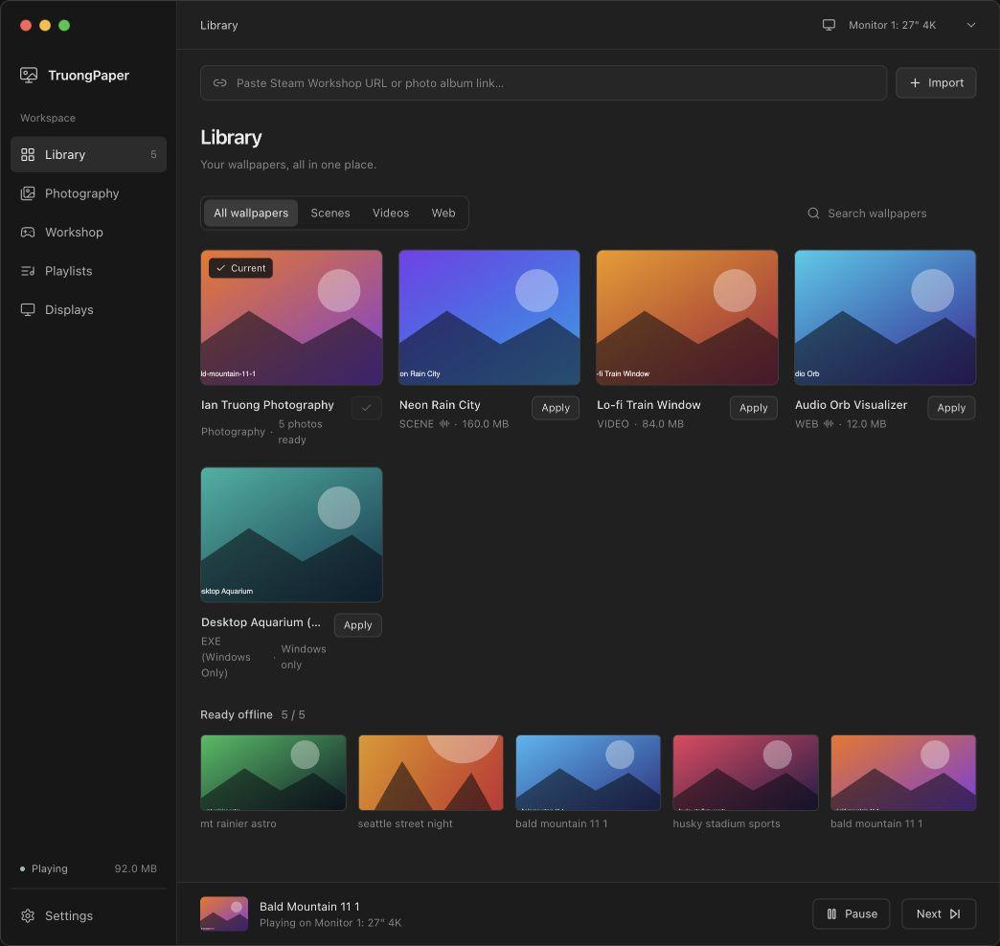
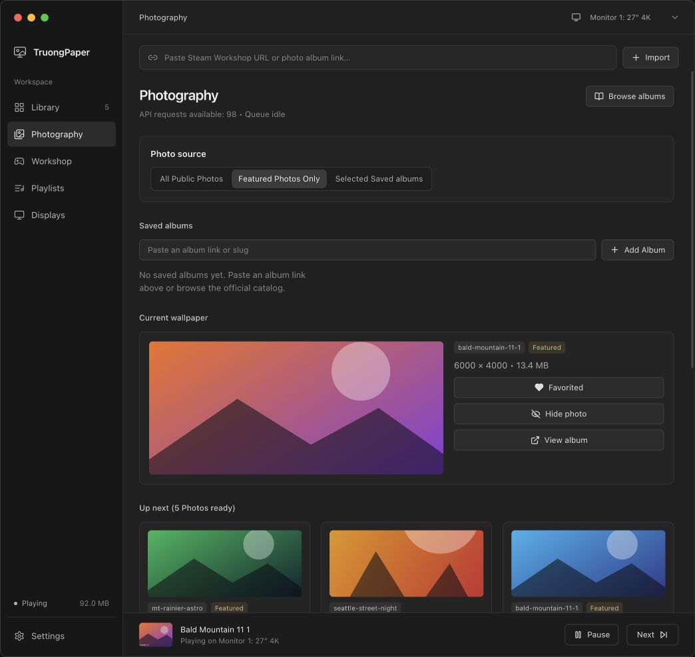
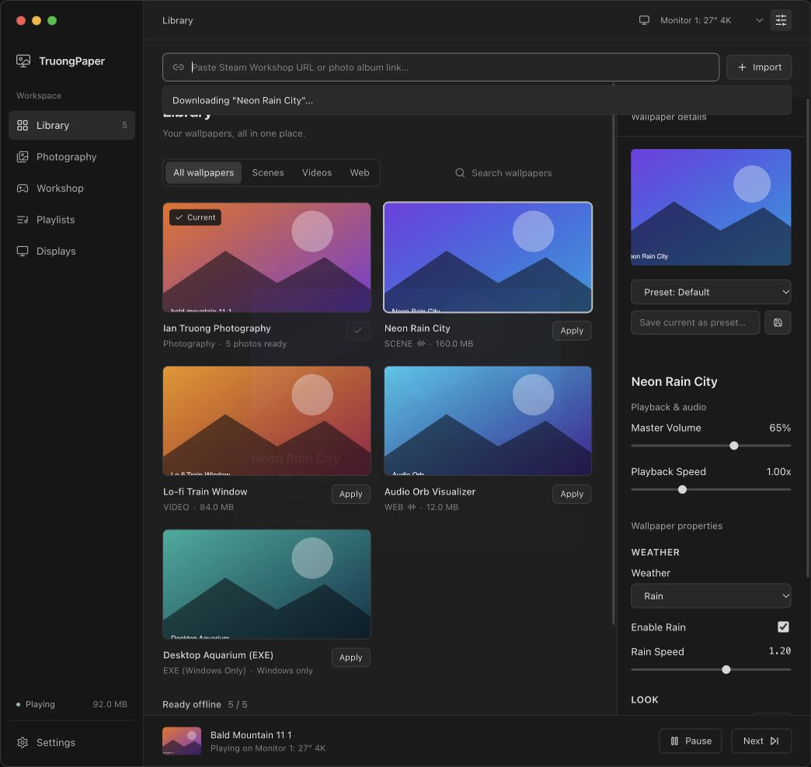
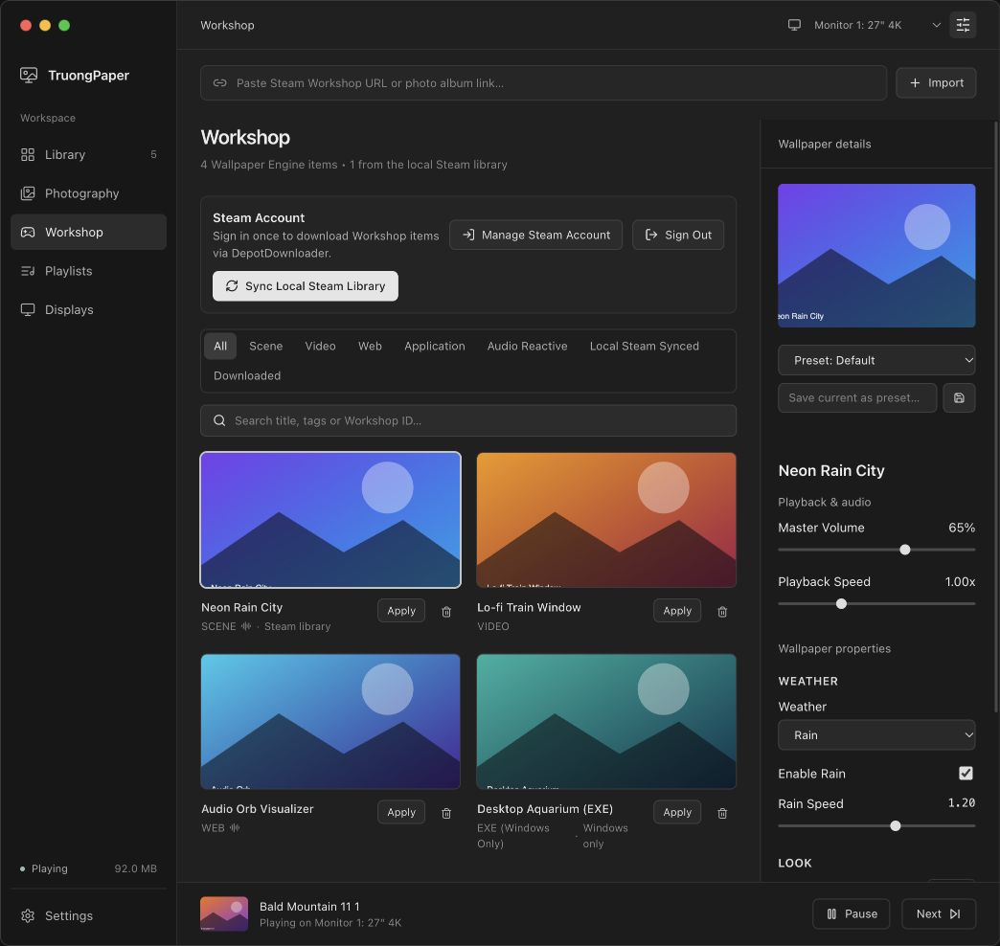
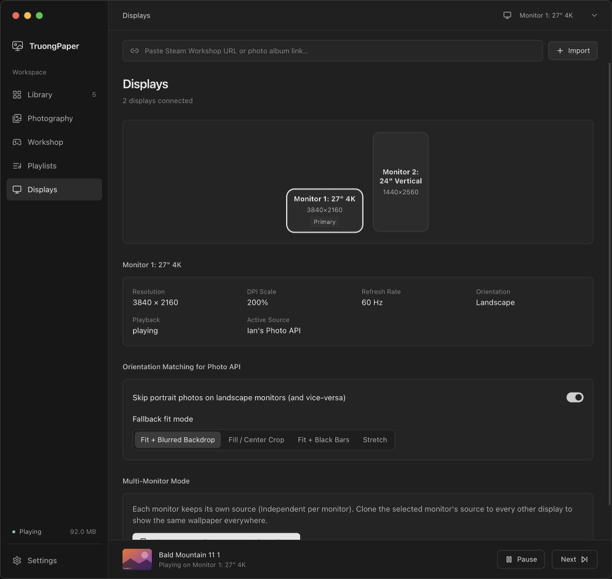
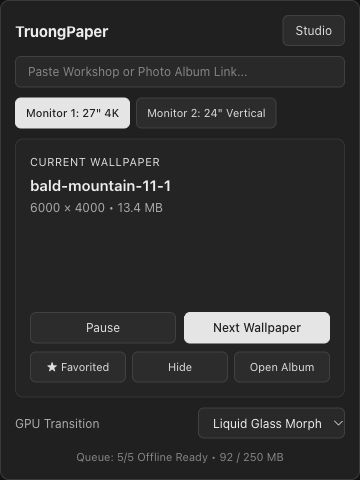

<div align="center">


# TruongPaper

A native macOS and Windows desktop wallpaper engine built in Rust and WebGPU that combines the [Ian Truong Photography API](https://iantruongphotography.com/apps/photo-api) with Steam Workshop downloads & experimental Wallpaper Engine compatibility inside a unified simple dark interface.

[Download for macOS](https://github.com/iant4093/TruongPaper/releases/latest/download/TruongPaper-macOS.dmg) · [Download for Windows](https://github.com/iant4093/TruongPaper/releases/latest/download/TruongPaper-Windows-Setup.exe) · [Releases](https://github.com/iant4093/TruongPaper/releases) · [Build status](https://github.com/iant4093/TruongPaper/actions) · [Report an issue](https://github.com/iant4093/TruongPaper/issues)

[](https://github.com/iant4093/TruongPaper/releases/latest/download/TruongPaper-macOS.dmg)
[](https://github.com/iant4093/TruongPaper/releases/latest/download/TruongPaper-Windows-Setup.exe)


[](https://github.com/iant4093/TruongPaper/actions/workflows/ci.yml)

</div>

---

TruongPaper renders live, audio-reactive and high-resolution photographic wallpapers directly behind your desktop icons on both macOS and Windows. It pairs an offline-first queue for the public [Ian Truong Photography API](https://iantruongphotography.com/apps/photo-api) with a built-in Steam Workshop downloader and native Rust renderer for Wallpaper Engine scenes, videos, web wallpapers and Windows applications, all wrapped in an simple dark interface that looks identical on macOS and Windows.

## Screenshots

The screenshots below use the interactive browser preview with sample wallpapers. The [native macOS screenshot](docs/screenshots/native-library.jpg) uses real photo API data.

<table>
  <tr>
    <td width="50%" valign="top">
      
      <p align="center"><sub><b>Wallpaper Library</b> · unified library, paste omnibar and live inspector</sub></p>
    </td>
    <td width="50%" valign="top">
      
      <p align="center"><sub><b>Ian's Photos API</b> · offline queue, saved albums and zero-repeat history</sub></p>
    </td>
  </tr>
  <tr>
    <td width="50%" valign="top">
      
      <p align="center"><sub><b>Steam Workshop</b> · paste any Workshop link to download and apply</sub></p>
    </td>
    <td width="50%" valign="top">
      
      <p align="center"><sub><b>Wallpaper Engine Inspector</b> · user properties, presets and audio FFT</sub></p>
    </td>
  </tr>
  <tr>
    <td width="50%" valign="top">
      
      <p align="center"><sub><b>Monitors & Playlists</b> · per-display fit modes and wallpaper transitions</sub></p>
    </td>
    <td width="50%" valign="top">
      
      <p align="center"><sub><b>Menu Bar & System Tray</b> · instant controls without opening the studio</sub></p>
    </td>
  </tr>
</table>

## Features

**Ian Truong Photography API & Offline Queue**

- Direct integration with `https://photos-api.iantruongphotography.com/v1/photos/random`: pull from all public photos, featured photos only (`?featured=true`), or any combination of saved albums (`?album=<slug>`)
- Browse the official public album catalog with cover thumbnails and photo counts, or paste any `https://iantruongphotography.com/album/...` URL or slug into the top omnibar
- Offline-first local queue: keeps 5 unused full-resolution JPEGs (`wallpapers/photos/<id>.jpg`) ready on disk and refills in the background when the queue drops to 2, so scheduled wallpaper changes happen instantly with zero API calls
- Persistent SQLite history (`photos_history`): checks every random pick against both the unused queue and shown history *before* downloading `imageUrl`, guaranteeing no photo repeats even after older image files are evicted to free disk space
- Smart exhaustion handling: when every photo in an album or filter has been shown, TruongPaper automatically resets the history for that filter and re-queues any photos still cached on disk (or holds on the last photo if preferred)
- Per-photo actions: Favorite / Pin on disk (exempts from cache cleanup), Hide / Never show again (blacklists ID and advances), and View Album on `iantruongphotography.com`
- Configurable disk cache limit (250 MB default, 100 MB – 10 GB slider) plus sliding-window rate limiting (respecting the 100 requests / 5 min API limit with automatic exponential backoff on `403`/`503`)

**Steam Workshop & Wallpaper Engine**

- Paste any Steam Workshop link (`https://steamcommunity.com/sharedfiles/filedetails/?id=...`) or Workshop ID to inspect metadata and download the wallpaper directly inside TruongPaper
- Built-in standalone Steam downloader powered by a bundled, checksum-verified `DepotDownloader` sidecar with Steam Mobile QR code and 2FA sign-in; refresh tokens are kept in macOS Keychain / Windows Credential Manager
- Automatic local Steam sync: discovers local Steam libraries (`libraryfolders.vdf`) and watches `steamapps/workshop/content/431960` in real time so subscriptions from the Steam client appear automatically
- First-run core asset bootstrap: automatically fetches Wallpaper Engine's core shaders and materials (`Depot 431961`) on macOS or Windows machines where Wallpaper Engine isn't installed locally

**Scene, Video, Web & Application Runtimes**

- **Scene wallpapers**: native Rust `.pkg` (`PKGV0001`–`PKGV0022+`) memory-mapped archive reader, `.tex` (`TEXV0005` / `TEXB0001`–`TEXB0004` / `TEXS0001`–`TEXS0003`) LZ4/DXT1/DXT3/DXT5/RG88/R8/MP4 texture decoder, 4-layer Virtual File System, HLSL/GLSL-to-WGSL shader preprocessor, multi-pass FBO effects, GPU/SIMD particle systems, `.mdl` skeletal puppet warp, and an embedded `rquickjs` SceneScript runtime (`init`, `update`, `cursorMove`, `applyUserProperties`, `engine.registerAudioBuffers`)
- **Video wallpapers**: looping playback through WKWebView / WebView2 (codec support depends on the platform), plus AVFoundation decoding for embedded scene videos on macOS with gapless loop, playback speed (`0.1x`–`3.0x`) and volume control
- **Web wallpapers**: embedded `wry` desktop WebView with `window.wallpaperPropertyListener` and 60 Hz 128-band stereo `window.wallpaperRegisterAudioListener` injection
- **Application wallpapers** (Windows): launches Windows application wallpapers with desktop bounds; flagged as `Windows Only` on macOS

**Inspector, Audio Reactivity & Desktop Interaction**

- Dynamic `project.json` inspector: automatically generates sliders, switches, color pickers, dropdowns, text inputs and file pickers for every wallpaper property, evaluating visibility `condition` expressions and localization tables in real time
- Universal per-wallpaper adjustments (Volume, Playback Speed, Fit Mode, Zoom/Offset, Brightness, Contrast, Saturation, Hue Shift) and named user presets
- System audio loopback + 2048-point Hann-windowed FFT (`WASAPI Loopback` on Windows; a virtual loopback device such as BlackHole on macOS) driving 16-, 32- and 64-band logarithmic stereo spectrums at 60 Hz
- Passive desktop cursor forwarding: tracks cursor movement and clicks over unoccluded desktop regions without stealing clicks from Finder or Windows desktop icons

**Multi-Monitor, GPU Transitions & Smart Pause**

- Independent per-monitor wallpapers and applying the same source across displays (photo draws remain independent), with platform support for both classic Windows 10/11 `WorkerW` and Windows 11 24H2 (`WS_EX_NOREDIRECTIONBITMAP`) raised layered desktops
- Smart orientation matching: skips portrait photos on landscape monitors (and vice-versa) by default, or displays mismatched aspect ratios over a dual-pass Kawase GPU-blurred ambient backdrop (`Fit + Blur`)
- Custom `wgpu` transitions: **Smooth Crossfade**, **Blur-Dissolve**, and **Liquid Glass Morph** (refractive chromatic dispersion shader) with adjustable duration (`0.3s`–`3.0s`)
- Unified playlists: rotate only Ian's Photo API, only Workshop wallpapers, or mix both on a custom timer (`1 min` to `24 hours`), on app launch, on display wake
- Smart pause & battery saver: suspends animation and FFT work and mutes audio when a fullscreen game or maximized window covers a monitor, when running on laptop battery / Low Power Mode, or when the screen locks or sleeps

## Install

This project is in preview testing. Test installers are available from [GitHub Actions](https://github.com/iant4093/TruongPaper/actions/workflows/ci.yml); release download links become available after the first approved publication. See [the testing checklist](docs/MANUAL-TESTING.md) and [remaining limitations](docs/RELEASE-READINESS.md).

**macOS** (Apple Silicon, macOS 14.2 or later)

1. Download [TruongPaper-macOS.dmg](https://github.com/iant4093/TruongPaper/releases/latest/download/TruongPaper-macOS.dmg) and drag TruongPaper into Applications.
2. Open TruongPaper. macOS will say it can't verify the developer, because release builds are ad-hoc signed rather than notarized. Click **Done**, then go to **System Settings › Privacy & Security**, scroll down to the message about TruongPaper and click **Open Anyway**, then confirm with your password. You only need to do this once.

**Windows** (x64, Windows 10 1809 or later / Windows 11)

1. Download [TruongPaper-Windows-Setup.exe](https://github.com/iant4093/TruongPaper/releases/latest/download/TruongPaper-Windows-Setup.exe) and run it.
2. If SmartScreen appears, choose **More info › Run anyway**. The installer is not code-signed.

Ian's Photos API works without an account or API key. Steam sign-in is only needed for the built-in Workshop downloader; subscriptions from a local Steam install are picked up without it. The `DepotDownloader` sidecar is included, so no other software is required. The download buttons always point to the most recent successfully published release.

Installed copies check for a new version once a day (or from **Settings › About**), show what changed, and install it when you choose after verifying its signature.

## Tech stack

| Area | Technologies |
|---|---|
| App shell | Tauri 2 (Rust), WKWebView on macOS, WebView2 on Windows |
| Interface | React 19, TypeScript, Vite, Framer Motion, Zustand, lucide-react, custom cross-platform Apple neutral dark theme |
| Desktop & GPU Engine | `wgpu` (Metal on macOS, DirectX 12 / Vulkan on Windows), `naga` (GLSL/WGSL shader translation), Win32 `Progman`/`WorkerW` (23H2 & 24H2) and macOS `NSWindow` (`kCGDesktopWindowLevel`) |
| Wallpaper Engine Formats | Custom Rust `.pkg` memory-mapped VFS, `.tex` decoder (`lz4_flex`, BC1/BC2/BC3, RG88, R8, RGBA8, MP4 streams), `.mdl` puppet mesh deformer, `rquickjs` SceneScript sandbox |
| Steam Workshop | Bundled checksum-verified `DepotDownloader` v3.4.0 sidecar, Steam Web API metadata client, `notify` local `431960` folder watcher, OS Keychain (`keyring`) |
| Photo API & Storage | `reqwest` (rustls), `imagesize`, SQLite (`rusqlite` WAL mode) with persistent `photos_history` and LRU disk cache eviction |
| Audio DSP | `cpal` (WASAPI Loopback / macOS virtual loopback device), `rustfft` 2048-point Hann-windowed logarithmic 16/32/64-band stereo analyzer |
| Delivery | GitHub Actions, macOS `.dmg`, Windows NSIS installer, signed auto-updates, SHA-256 checksums |

## Build locally

Requires **Node 22.12+**, **Rust stable** and the [Tauri prerequisites](https://v2.tauri.app/start/prerequisites/) for your platform.

```bash
npm install

# Desktop app with hot reload (automatically downloads and verifies DepotDownloader sidecar)
npm run app:dev

# UI-only preview in a browser, with a mocked backend and sample data
npm run dev

# Download and checksum-verify the DepotDownloader sidecar into src-tauri/bin/
npm run bundle:depotdownloader

# Release build: bundles sidecars, builds installers, signs updates, writes latest.json
npm run app:build
```

Desktop dev/build commands automatically prepare the checksum-verified `DepotDownloader` sidecar and its license files. Run `npm run bundle:depotdownloader` before running Rust tests directly.

`app:build` signs updates with `~/.tauri/truongpaper.key` or `$TAURI_SIGNING_PRIVATE_KEY`. Generate a key once with `npx tauri signer generate -w ~/.tauri/truongpaper.key`. Without it, use `npx tauri build` for an unsigned local build.

## Tests

```bash
# Frontend unit and component tests (Vitest)
npm test

# TypeScript check and production frontend build
npm run build

# Rust unit tests: Photo API queue & history retention, rate limiter, small-album refill,
# .pkg/.tex/.mdl binary parsers, shader preprocessor, audio FFT, VFS and keychain vault
cd src-tauri && cargo test --workspace --locked

# Renderer smoke test: initializes a wgpu adapter and compiles the compositor and Kawase blur shaders.
# With TRUONGPAPER_SMOKE_PROBE=1 on Windows it also verifies the Progman desktop window is found.
cd src-tauri && cargo run --example wallpaper_smoke
```

## CI and releases

Pull requests and pushes to `main` run:

1. Vitest unit tests, a TypeScript check and a production frontend build.
2. macOS and Windows builds: `DepotDownloader` sidecar bundling, Rust tests and installer packaging.
3. A Windows wallpaper smoke test that initializes a `wgpu` adapter, compiles the compositor shaders and locates the `Progman` desktop window, failing the build if either step breaks.

Pushes to `main` produce test installers in the Actions artifacts. After desktop acceptance testing, manually run **CI** on `main` with **publish** enabled to publish a GitHub Release `v<major>.<minor>.<run number>` containing `TruongPaper-macOS.dmg`, `TruongPaper-Windows-Setup.exe`, the macOS updater archive (`TruongPaper-macOS.app.tar.gz`), `latest.json` (with the update signatures) and `SHA256SUMS`. The release notes are generated from the commit messages since the previous release, and the same list appears in the app's update prompt. Installed apps pick up the new version through `latest.json`. Pull requests and ordinary pushes never publish.

The updater signing key is stored as the `TAURI_SIGNING_PRIVATE_KEY` repository secret. Builds without it (such as fork pull requests) still produce installers, just without update signatures. GitHub Actions are pinned to commit SHAs, and Dependabot checks them weekly.

## Repository layout

```text
.
├── src/                    React app (Wallpaper Library & Menu Bar / Tray Popover)
│   ├── components/         Studio views (views/), PropertyInspector, Omnibar,
│   │                       AmbientBacklightCanvas, Steam sign-in and Workshop preview modals
│   ├── services/           Signed auto-updater client (updates.ts)
│   ├── store/              Zustand store (useAppStore.ts): photos, Workshop, playlists, monitors, presets
│   ├── tray/               Menu Bar (macOS) / System Tray (Windows) quick-control popover
│   ├── lib/ types/         Formatting helpers and IPC types (ipc.ts)
│   ├── styles/             Neutral dark theme (theme.css)
│   └── dev/                Browser-preview mock of the Tauri backend (dev only)
├── src-tauri/              Rust backend
│   ├── crates/             Modular crates: core, photo-api, steam, we-formats, renderer, scenescript, audio, platform
│   ├── src/                Tauri entrypoints, IPC commands (commands/), desktop host, Smart Pause,
│   │                       power/lock watcher, OS keychain vault, wpe:// protocol, tray, SQLite state
│   ├── capabilities/       Tauri permissions
│   ├── bin/                DepotDownloader sidecar and licenses (populated by the bundler script)
│   └── examples/           Renderer smoke test (wallpaper_smoke.rs)
├── tests/                  Vitest unit and component tests
├── scripts/                DepotDownloader sidecar bundling and release packaging
├── docs/                   Architecture specs, README screenshots and icon
├── .github/                CI/release workflow and Dependabot
├── index.html              Main Studio window entry
├── tray.html               Menu Bar / System Tray popover entry
└── README.md
```

TruongPaper is an independent project and is not affiliated with or endorsed by Valve, Steam or Wallpaper Engine. Workshop wallpapers belong to their creators, and `DepotDownloader` is bundled under its GPL-2.0 license.
