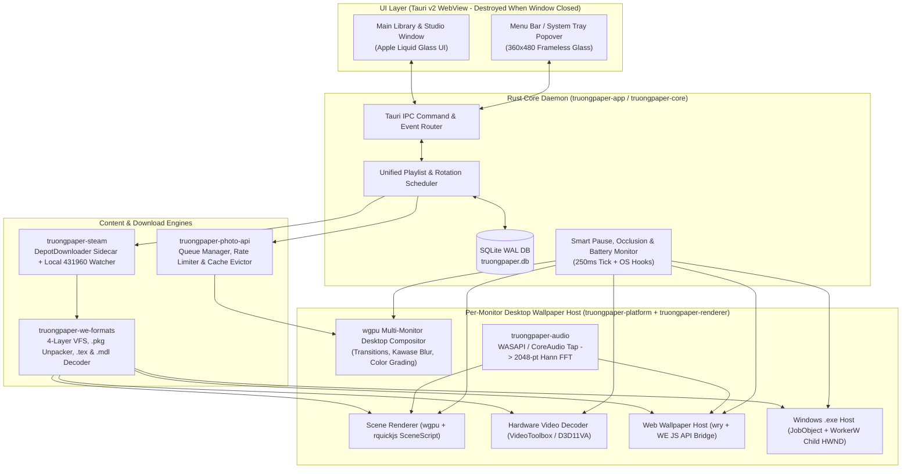

# 01 — System Architecture, OS Desktop Host, GPU Shaders & Audio DSP

> **Implementation Tier**: Copy-Paste Ready / Zero-Ambiguity Specification  
> All OS windowing quirks (including the **Windows 11 24H2 `WS_EX_NOREDIRECTIONBITMAP` breaking change** and **macOS `WKWebView`/`CAMetalLayer` occlusion throttling**), WGSL transition shaders, and FFT audio binning formulas are specified with concrete Rust & WGSL code below.

---

## 1. High-Level Process & Thread Model



---

## 2. Cross-Platform Desktop Window Embedding (`truongpaper-platform`)

### 2.1 Windows Desktop Integration (Classic Win10/11 23H2 AND Windows 11 24H2+)

> [!IMPORTANT]
> **Critical Windows 11 24H2 Breaking Change (`WS_EX_NOREDIRECTIONBITMAP`)**  
> In Windows 10 through Windows 11 23H2, sending `0x052C` to `Progman` spawns a top-level sibling `WorkerW` behind the `WorkerW` that owns `SHELLDLL_DefView`.  
> In **Windows 11 24H2 (Build 26100+)**, Microsoft changed the desktop shell ("Raised Desktop with Layered ShellView"):
> 1. `Progman` has extended style `WS_EX_NOREDIRECTIONBITMAP` (`0x00200000`).
> 2. `SHELLDLL_DefView` is a `WS_EX_LAYERED` direct child of `Progman`.
> 3. `WorkerW` is ALSO a direct child of `Progman` (`FindWindowExW(progman, None, w!("WorkerW"), None)`).
> 4. On 24H2, you **MUST** style your render `HWND` with `WS_CHILD` + `WS_EX_LAYERED` (`SetLayeredWindowAttributes(hwnd, 0, 255, LWA_ALPHA)`), call `SetParent(hwnd, progman)`, and Z-order `hwnd` immediately below `SHELLDLL_DefView` and above `WorkerW`!
> 5. On 24H2, **NEVER call `SystemParametersInfoW(SPI_SETDESKWALLPAPER, ...)`** to refresh the desktop, because doing so destroys the child `WorkerW`!

#### Reference Rust Implementation (`crates/truongpaper-platform/src/windows_desktop.rs`)

```rust
#[cfg(target_os = "windows")]
pub mod win_desktop {
    use std::sync::OnceLock;
    use windows::core::{w, PCWSTR};
    use windows::Win32::Foundation::{BOOL, COLORREF, HWND, LPARAM, LRESULT, POINT, RECT, WPARAM};
    use windows::Win32::Graphics::Gdi::{
        EnumDisplayMonitors, GetMonitorInfoW, MapWindowPoints, HDC, HMONITOR, MONITORINFOEXW,
    };
    use windows::Win32::System::LibraryLoader::GetModuleHandleW;
    use windows::Win32::UI::WindowsAndMessaging::*;

    #[derive(Debug, Clone, Copy)]
    pub struct DesktopHandles {
        pub progman: HWND,
        pub shell_dll_defview: HWND,
        pub worker_w: HWND,
        /// True on Windows 11 24H2+ where Progman has WS_EX_NOREDIRECTIONBITMAP
        pub is_raised_layered_desktop: bool,
    }

    #[derive(Debug, Clone)]
    pub struct Win32MonitorDesc {
        pub device_name: String,
        pub monitor_rect: RECT,
        pub work_rect: RECT,
        pub is_primary: bool,
    }

    #[derive(Debug, Clone)]
    pub enum DesktopLifecycleEvent {
        /// explorer.exe restarted; re-run setup_desktop_layer() and re-parent/recreate wallpaper HWNDs
        ExplorerRestarted,
        /// Monitor plugged/unplugged, resolution changed, or work area updated
        DisplayTopologyChanged(Vec<Win32MonitorDesc>),
    }

    pub unsafe fn enumerate_monitors_win32() -> Vec<Win32MonitorDesc> {
        let mut list: Vec<Win32MonitorDesc> = Vec::new();

        unsafe extern "system" fn monitor_enum_proc(
            hmonitor: HMONITOR,
            _hdc: HDC,
            _lprect: *mut RECT,
            lparam: LPARAM,
        ) -> BOOL {
            let out = &mut *(lparam.0 as *mut Vec<Win32MonitorDesc>);
            let mut mi = MONITORINFOEXW::default();
            mi.monitorInfo.cbSize = std::mem::size_of::<MONITORINFOEXW>() as u32;
            if GetMonitorInfoW(hmonitor, &mut mi.monitorInfo as *mut _ as *mut _).as_bool() {
                let len = mi.szDevice.iter().position(|&c| c == 0).unwrap_or(mi.szDevice.len());
                let device_name = String::from_utf16_lossy(&mi.szDevice[..len]);
                let is_primary = (mi.monitorInfo.dwFlags & MONITORINFOF_PRIMARY) != 0;
                out.push(Win32MonitorDesc {
                    device_name,
                    monitor_rect: mi.monitorInfo.rcMonitor,
                    work_rect: mi.monitorInfo.rcWork,
                    is_primary,
                });
            }
            BOOL(1)
        }

        let _ = EnumDisplayMonitors(
            None,
            None,
            Some(monitor_enum_proc),
            LPARAM(&mut list as *mut Vec<Win32MonitorDesc> as isize),
        );
        list
    }

    pub unsafe fn setup_desktop_layer() -> Option<DesktopHandles> {
        let progman = FindWindowW(w!("Progman"), PCWSTR::null()).ok()?;
        if progman.0.is_null() {
            return None;
        }

        let ex_style = GetWindowLongPtrW(progman, GWL_EXSTYLE) as u32;
        let is_raised_layered_desktop = (ex_style & WS_EX_NOREDIRECTIONBITMAP.0) != 0;

        // Spawn WorkerW behind desktop icons
        let mut _result: usize = 0;
        let _ = SendMessageTimeoutW(
            progman,
            0x052C,
            WPARAM(0xD),
            LPARAM(0x1),
            SMTO_NORMAL,
            1000,
            Some(&mut _result),
        );

        struct FindCtx {
            shell_view: HWND,
            worker_w: HWND,
        }
        let mut ctx = FindCtx {
            shell_view: HWND::default(),
            worker_w: HWND::default(),
        };

        unsafe extern "system" fn enum_proc(top_hwnd: HWND, lparam: LPARAM) -> BOOL {
            let ctx = &mut *(lparam.0 as *mut FindCtx);
            if let Ok(def_view) =
                FindWindowExW(Some(top_hwnd), None, w!("SHELLDLL_DefView"), PCWSTR::null())
            {
                if !def_view.0.is_null() {
                    ctx.shell_view = def_view;
                    if let Ok(next_worker) =
                        FindWindowExW(None, Some(top_hwnd), w!("WorkerW"), PCWSTR::null())
                    {
                        ctx.worker_w = next_worker;
                    }
                }
            }
            BOOL(1)
        }

        let _ = EnumWindows(Some(enum_proc), LPARAM(&mut ctx as *mut FindCtx as isize));
        let shell_dll_defview = ctx.shell_view;
        let mut worker_w = ctx.worker_w;

        // Windows 11 24H2 override: WorkerW is a direct child of Progman below SHELLDLL_DefView
        if is_raised_layered_desktop {
            if let Ok(child_worker) =
                FindWindowExW(Some(progman), None, w!("WorkerW"), PCWSTR::null())
            {
                if !child_worker.0.is_null() {
                    worker_w = child_worker;
                }
            }
        }

        if worker_w.0.is_null() {
            return None;
        }

        Some(DesktopHandles {
            progman,
            shell_dll_defview,
            worker_w,
            is_raised_layered_desktop,
        })
    }

    /// Attaches a per-monitor wallpaper HWND behind the desktop icons for `monitor_bounds` (in virtual screen coords).
    pub unsafe fn attach_hwnd_to_desktop(
        hwnd: HWND,
        desktop: &DesktopHandles,
        monitor_bounds: RECT,
    ) -> bool {
        if !IsWindow(Some(hwnd)).as_bool() {
            return false;
        }

        // 1. Move window to target monitor coordinates in virtual screen space first
        let _ = SetWindowPos(
            hwnd,
            Some(HWND_BOTTOM),
            monitor_bounds.left,
            monitor_bounds.top,
            monitor_bounds.right - monitor_bounds.left,
            monitor_bounds.bottom - monitor_bounds.top,
            SWP_NOACTIVATE,
        );

        // 2. Map monitor rectangle into target parent client coordinates using [POINT; 2]
        let target_parent = if desktop.is_raised_layered_desktop {
            desktop.progman
        } else {
            desktop.worker_w
        };
        let mut mapped_rect = RECT::default();
        let _ = GetWindowRect(hwnd, &mut mapped_rect);
        let mut pts = [
            POINT {
                x: mapped_rect.left,
                y: mapped_rect.top,
            },
            POINT {
                x: mapped_rect.right,
                y: mapped_rect.bottom,
            },
        ];
        let _ = MapWindowPoints(Some(HWND::default()), Some(target_parent), &mut pts);

        // 3. Apply parent and Z-order depending on Win11 24H2 vs classic WorkerW
        if desktop.is_raised_layered_desktop {
            let style = GetWindowLongPtrW(hwnd, GWL_STYLE) as u32;
            let new_style = (style & !WS_POPUP.0) | WS_CHILD.0 | WS_VISIBLE.0;
            SetWindowLongPtrW(hwnd, GWL_STYLE, new_style as isize);

            // MUST add WS_EX_LAYERED with alpha=255 BEFORE SetParent on 24H2
            let ex_style = GetWindowLongPtrW(hwnd, GWL_EXSTYLE) as u32;
            SetWindowLongPtrW(hwnd, GWL_EXSTYLE, (ex_style | WS_EX_LAYERED.0) as isize);
            let _ = SetLayeredWindowAttributes(hwnd, COLORREF(0), 255, LWA_ALPHA);

            let _ = SetParent(hwnd, Some(desktop.progman));

            // Order hwnd directly beneath SHELLDLL_DefView
            let _ = SetWindowPos(
                hwnd,
                Some(desktop.shell_dll_defview),
                pts[0].x,
                pts[0].y,
                monitor_bounds.right - monitor_bounds.left,
                monitor_bounds.bottom - monitor_bounds.top,
                SWP_NOACTIVATE,
            );

            // Ensure WorkerW stays at the very bottom of Progman's children
            let _ = SetWindowPos(
                desktop.worker_w,
                Some(HWND_BOTTOM),
                0,
                0,
                0,
                0,
                SWP_NOMOVE | SWP_NOSIZE | SWP_NOACTIVATE,
            );
        } else {
            let style = GetWindowLongPtrW(hwnd, GWL_STYLE) as u32;
            let new_style = (style & !WS_POPUP.0) | WS_CHILD.0 | WS_VISIBLE.0;
            SetWindowLongPtrW(hwnd, GWL_STYLE, new_style as isize);

            let _ = SetParent(hwnd, Some(desktop.worker_w));
            let _ = SetWindowPos(
                hwnd,
                Some(HWND::default()),
                pts[0].x,
                pts[0].y,
                monitor_bounds.right - monitor_bounds.left,
                monitor_bounds.bottom - monitor_bounds.top,
                SWP_NOACTIVATE | SWP_NOZORDER,
            );

            // Refresh desktop only on classic non-24H2 (on 24H2 this would destroy WorkerW!)
            let _ = SystemParametersInfoW(SPI_SETDESKWALLPAPER, 0, None, SPIF_UPDATEINIFILE);
        }

        true
    }

    static TASKBAR_CREATED_MSG: OnceLock<u32> = OnceLock::new();
    static LIFECYCLE_TX: OnceLock<crossbeam_channel::Sender<DesktopLifecycleEvent>> =
        OnceLock::new();

    unsafe extern "system" fn lifecycle_wndproc(
        hwnd: HWND,
        msg: u32,
        wparam: WPARAM,
        lparam: LPARAM,
    ) -> LRESULT {
        let taskbar_msg = *TASKBAR_CREATED_MSG.get().unwrap_or(&0);
        if taskbar_msg != 0 && msg == taskbar_msg {
            if let Some(tx) = LIFECYCLE_TX.get() {
                let _ = tx.send(DesktopLifecycleEvent::ExplorerRestarted);
            }
        } else if msg == WM_DISPLAYCHANGE
            || (msg == WM_SETTINGCHANGE && wparam.0 == SPI_SETWORKAREA.0 as usize)
        {
            if let Some(tx) = LIFECYCLE_TX.get() {
                let _ = tx.send(DesktopLifecycleEvent::DisplayTopologyChanged(
                    enumerate_monitors_win32(),
                ));
            }
        }
        DefWindowProcW(hwnd, msg, wparam, lparam)
    }

    /// Spawns a dedicated Win32 message listener that catches `TaskbarCreated` (explorer.exe crash/restart)
    /// and `WM_DISPLAYCHANGE` / `SPI_SETWORKAREA` (monitor hotplug, resolution, or DPI scaling changes).
    pub fn spawn_desktop_lifecycle_watcher(
        tx: crossbeam_channel::Sender<DesktopLifecycleEvent>,
    ) {
        let _ = LIFECYCLE_TX.set(tx);
        std::thread::spawn(|| unsafe {
            let msg_id = RegisterWindowMessageW(w!("TaskbarCreated"));
            let _ = TASKBAR_CREATED_MSG.set(msg_id);

            let hinstance = GetModuleHandleW(PCWSTR::null()).unwrap_or_default();
            let class_name = w!("TruongPaperLifecycleWatcher");
            let wc = WNDCLASSEXW {
                cbSize: std::mem::size_of::<WNDCLASSEXW>() as u32,
                lpfnWndProc: Some(lifecycle_wndproc),
                hInstance: hinstance.into(),
                lpszClassName: class_name,
                ..Default::default()
            };
            RegisterClassExW(&wc);

            // Must be a top-level WS_POPUP window (NOT HWND_MESSAGE) to receive TaskbarCreated and WM_DISPLAYCHANGE broadcasts
            if let Ok(_hwnd) = CreateWindowExW(
                WS_EX_TOOLWINDOW | WS_EX_NOACTIVATE,
                class_name,
                w!(""),
                WS_POPUP,
                0,
                0,
                0,
                0,
                None,
                None,
                Some(hinstance.into()),
                None,
            ) {
                let mut msg = MSG::default();
                while GetMessageW(&mut msg, None, 0, 0).as_bool() {
                    let _ = TranslateMessage(&msg);
                    let _ = DispatchMessageW(&msg);
                }
            }
        });
    }
}
```

---

### 2.2 macOS Desktop Integration (`NSWindow` at `kCGDesktopWindowLevel`)

> [!IMPORTANT]
> **Critical macOS Occlusion Quirk (`NSWindow.occlusionState`)**  
> By default on macOS, when a user opens a maximized or large window over the desktop, AppKit marks the desktop-level `NSWindow` as occluded (`NSWindowOcclusionStateVisible == 0`). This causes `WKWebView` (for `Web` wallpapers) to immediately suspend `requestAnimationFrame` and causes `CAMetalLayer` to throttle display sync!  
> To ensure TruongPaper's own Smart Pause engine has 100% deterministic control over when wallpapers pause vs. play, subclass `NSWindow` and override `occlusionState` to return `NSWindowOcclusionStateVisible` (`1 << 1`) whenever TruongPaper's policy state for that monitor is `Playing`.

#### Reference Rust Implementation (`crates/truongpaper-platform/src/macos_desktop.rs`)

```rust
#[cfg(target_os = "macos")]
pub mod mac_desktop {
    use block2::RcBlock;
    use objc2::rc::Retained;
    use objc2::runtime::{AnyObject, NSObject};
    use objc2::{class, define_class, msg_send, MainThreadMarker, MainThreadOnly};
    use objc2_app_kit::{
        NSBackingStoreType, NSResponder, NSScreen, NSWindow, NSWindowCollectionBehavior,
        NSWindowOcclusionState, NSWindowStyleMask,
    };
    use objc2_core_graphics::{CGWindowLevelForKey, CGWindowLevelKey};
    use objc2_foundation::{NSNumber, NSRect, NSString};

    define_class!(
        // SAFETY:
        // - NSWindow -> NSResponder -> NSObject is the exact inheritance chain.
        // - TruongDesktopWindow is MainThreadOnly and does not implement Drop.
        #[unsafe(super(NSWindow, NSResponder, NSObject))]
        #[thread_kind = MainThreadOnly]
        #[name = "TruongDesktopWindow"]
        pub struct TruongDesktopWindow;

        impl TruongDesktopWindow {
            /// Always report Visible so macOS never throttles WKWebView requestAnimationFrame
            /// or CAMetalLayer display sync when normal windows cover the desktop.
            #[unsafe(method(occlusionState))]
            fn __occlusion_state(&self) -> NSWindowOcclusionState {
                NSWindowOcclusionState::Visible
            }

            #[unsafe(method(canBecomeKeyWindow))]
            fn __can_become_key_window(&self) -> bool {
                false
            }

            #[unsafe(method(canBecomeMainWindow))]
            fn __can_become_main_window(&self) -> bool {
                false
            }
        }
    );

    /// Extracts the persistent CoreGraphics `CGDirectDisplayID` (`u32`) for an `NSScreen`.
    pub fn screen_display_id(screen: &NSScreen) -> u32 {
        let desc = screen.deviceDescription();
        let key = NSString::from_str("NSScreenNumber");
        if let Some(obj) = desc.objectForKey(&key) {
            let num: &NSNumber = unsafe { &*(Retained::as_ptr(&obj) as *const NSNumber) };
            return num.unsignedIntValue();
        }
        0
    }

    pub fn create_desktop_window_for_screen(
        mtm: MainThreadMarker,
        screen: &NSScreen,
    ) -> Retained<NSWindow> {
        let frame: NSRect = screen.frame();
        let style = NSWindowStyleMask::Borderless;

        let window: Retained<TruongDesktopWindow> = unsafe {
            let alloc = mtm.alloc::<TruongDesktopWindow>();
            msg_send![
                super(alloc, NSWindow::class()),
                initWithContentRect: frame,
                styleMask: style,
                backing: NSBackingStoreType::Buffered,
                defer: false
            ]
        };

        let ns_window: Retained<NSWindow> = unsafe { Retained::cast_unchecked(window) };
        unsafe {
            ns_window.setReleasedWhenClosed(false);
        }

        // Sit directly above root wallpaper and below Finder desktop icons
        let desktop_level =
            CGWindowLevelForKey(CGWindowLevelKey::DesktopWindowLevelKey) as isize;
        ns_window.setLevel(desktop_level);

        // Persist across all Spaces, Stage Manager, and Mission Control
        ns_window.setCollectionBehavior(
            NSWindowCollectionBehavior::CanJoinAllSpaces
                | NSWindowCollectionBehavior::Stationary
                | NSWindowCollectionBehavior::IgnoresCycle
                | NSWindowCollectionBehavior::FullScreenAuxiliary,
        );

        ns_window.setOpaque(true);
        ns_window.setHasShadow(false);
        // Let Finder desktop icons receive direct clicks; forward cursor via global monitor
        ns_window.setIgnoresMouseEvents(true);
        ns_window.setRestorable(false);
        ns_window.orderFrontRegardless();

        ns_window
    }

    #[derive(Debug, Clone, Copy, PartialEq, Eq)]
    pub enum MacScreenEvent {
        /// Fired on NSApplicationDidChangeScreenParametersNotification (monitor hotplug, resolution, HiDPI scale)
        ScreenParametersChanged,
        /// Fired on NSWorkspaceActiveSpaceDidChangeNotification (Space swipe / Full Screen transition)
        ActiveSpaceChanged,
    }

    /// Registers main-queue observers for display hotplug/resolution changes and macOS Spaces transitions.
    pub fn start_screen_and_space_observer(
        on_event: impl Fn(MacScreenEvent) + Send + Sync + 'static,
    ) {
        let on_event = std::sync::Arc::new(on_event);

        unsafe {
            let queue: *mut AnyObject = msg_send![class!(NSOperationQueue), mainQueue];
            let nil: *mut AnyObject = std::ptr::null_mut();

            // 1. Display hotplug / resolution / arrangement change on NSNotificationCenter.defaultCenter
            let default_center: *mut AnyObject =
                msg_send![class!(NSNotificationCenter), defaultCenter];
            let screen_name =
                NSString::from_str("NSApplicationDidChangeScreenParametersNotification");
            let cb_screen = std::sync::Arc::clone(&on_event);
            let screen_block = RcBlock::new(move |_note: *mut AnyObject| {
                cb_screen(MacScreenEvent::ScreenParametersChanged);
            });
            let token1: *mut AnyObject = msg_send![
                default_center,
                addObserverForName: &*screen_name,
                object: nil,
                queue: queue,
                usingBlock: &*screen_block
            ];
            let _: *mut AnyObject = msg_send![token1, retain];

            // 2. Active Space change on NSWorkspace.sharedWorkspace.notificationCenter
            let workspace: *mut AnyObject = msg_send![class!(NSWorkspace), sharedWorkspace];
            let ws_center: *mut AnyObject = msg_send![workspace, notificationCenter];
            let space_name =
                NSString::from_str("NSWorkspaceActiveSpaceDidChangeNotification");
            let cb_space = std::sync::Arc::clone(&on_event);
            let space_block = RcBlock::new(move |_note: *mut AnyObject| {
                cb_space(MacScreenEvent::ActiveSpaceChanged);
            });
            let token2: *mut AnyObject = msg_send![
                ws_center,
                addObserverForName: &*space_name,
                object: nil,
                queue: queue,
                usingBlock: &*space_block
            ];
            let _: *mut AnyObject = msg_send![token2, retain];
        }
    }
}
```

---

## 3. Complete WGSL Shaders for Desktop Compositor (`truongpaper-renderer`)

All static photos, `Scene` outputs, and `Video` frames pass through the per-monitor `wgpu` compositor. Below is the exact, complete WGSL shader code for:
1. Dual-Pass Kawase Blur (used for both `Fit + Blur` ambient photo backdrops and the `Blur-Dissolve` transition).
2. All 3 Transition Modes (`Smooth Crossfade`, `Blur-Dissolve`, `Liquid Glass Morph`) + Color Grading (`Brightness`, `Contrast`, `Saturation`, `Hue Shift`).

### 3.1 Dual-Pass Kawase Blur Shader (`crates/truongpaper-renderer/src/shaders/kawase_blur.wgsl`)

```wgsl
struct BlurUniforms {
    texel_size: vec2<f32>,
    offset: f32,
    _pad: f32,
};

@group(0) @binding(0) var t_input: texture_2d<f32>;
@group(0) @binding(1) var s_linear: sampler;
@group(0) @binding(2) var<uniform> u_blur: BlurUniforms;

struct VertexOutput {
    @builtin(position) pos: vec4<f32>,
    @location(0) uv: vec2<f32>,
};

@vertex
fn vs_main(@builtin(vertex_index) vid: u32) -> VertexOutput {
    // Fullscreen triangle
    let x = f32((vid << 1u) & 2u);
    let y = f32(vid & 2u);
    var out: VertexOutput;
    out.pos = vec4<f32>(x * 2.0 - 1.0, 1.0 - y * 2.0, 0.0, 1.0);
    out.uv = vec2<f32>(x, y);
    return out;
}

@fragment
fn fs_downsample(in: VertexOutput) -> @location(0) vec4<f32> {
    let halfpixel = 0.5 * u_blur.texel_size * u_blur.offset;
    var sum = textureSample(t_input, s_linear, in.uv) * 4.0;
    sum += textureSample(t_input, s_linear, in.uv - halfpixel.xy);
    sum += textureSample(t_input, s_linear, in.uv + halfpixel.xy);
    sum += textureSample(t_input, s_linear, in.uv + vec2<f32>(halfpixel.x, -halfpixel.y));
    sum += textureSample(t_input, s_linear, in.uv - vec2<f32>(halfpixel.x, -halfpixel.y));
    return sum / 8.0;
}

@fragment
fn fs_upsample(in: VertexOutput) -> @location(0) vec4<f32> {
    let halfpixel = 0.5 * u_blur.texel_size * u_blur.offset;
    var sum = textureSample(t_input, s_linear, in.uv + vec2<f32>(-halfpixel.x * 2.0, 0.0));
    sum += textureSample(t_input, s_linear, in.uv + vec2<f32>(-halfpixel.x, halfpixel.y)) * 2.0;
    sum += textureSample(t_input, s_linear, in.uv + vec2<f32>(0.0, halfpixel.y * 2.0));
    sum += textureSample(t_input, s_linear, in.uv + vec2<f32>(halfpixel.x, halfpixel.y)) * 2.0;
    sum += textureSample(t_input, s_linear, in.uv + vec2<f32>(halfpixel.x * 2.0, 0.0));
    sum += textureSample(t_input, s_linear, in.uv + vec2<f32>(halfpixel.x, -halfpixel.y)) * 2.0;
    sum += textureSample(t_input, s_linear, in.uv + vec2<f32>(0.0, -halfpixel.y * 2.0));
    sum += textureSample(t_input, s_linear, in.uv + vec2<f32>(-halfpixel.x, -halfpixel.y)) * 2.0;
    return sum / 12.0;
}
```

### 3.2 Unified Fit-Mode, Transition & Color Grading Shader (`crates/truongpaper-renderer/src/shaders/compositor.wgsl`)

```wgsl
struct CompositorUniforms {
    // progress in [0.0, 1.0], already cubic-bezier eased by CPU or eased in shader
    progress: f32,
    // 0 = Smooth Crossfade, 1 = Blur-Dissolve, 2 = Liquid Glass Morph
    transition_mode: u32,
    // 0 = Fill (Cover), 1 = Fit + Blurred Backdrop, 2 = Fit + Black Bars, 3 = Stretch
    from_fit_mode: u32,
    to_fit_mode: u32,
    // Aspect ratios (width / height)
    monitor_aspect: f32,
    from_image_aspect: f32,
    to_image_aspect: f32,
    zoom: f32,          // default 1.0
    offset_x: f32,      // [-1.0, 1.0], default 0.0
    offset_y: f32,      // [-1.0, 1.0], default 0.0
    // Color grading
    brightness: f32,    // [-1.0, 1.0], default 0.0
    contrast: f32,      // [0.0, 2.0], default 1.0
    saturation: f32,    // [0.0, 2.0], default 1.0
    hue_shift: f32,     // [-3.14159, 3.14159], default 0.0
    time: f32,
    _pad: f32,
    // Span mode sub-rectangle of the shared canvas: canvas_uv = offset + uv * scale.
    span_offset_x: f32,
    span_offset_y: f32,
    span_scale_x: f32,
    span_scale_y: f32,
};

@group(0) @binding(0) var t_from: texture_2d<f32>;
@group(0) @binding(1) var t_to: texture_2d<f32>;
@group(0) @binding(2) var t_from_blurred: texture_2d<f32>;
@group(0) @binding(3) var t_to_blurred: texture_2d<f32>;
@group(0) @binding(4) var s_linear: sampler;
@group(0) @binding(5) var<uniform> u: CompositorUniforms;

struct VertexOutput {
    @builtin(position) pos: vec4<f32>,
    @location(0) uv: vec2<f32>,
};

@vertex
fn vs_main(@builtin(vertex_index) vid: u32) -> VertexOutput {
    let x = f32((vid << 1u) & 2u);
    let y = f32(vid & 2u);
    var out: VertexOutput;
    out.pos = vec4<f32>(x * 2.0 - 1.0, 1.0 - y * 2.0, 0.0, 1.0);
    out.uv = vec2<f32>(x, y);
    return out;
}

// Maps monitor-local UV to the (possibly shared, span mode) canvas UV.
fn canvas_uv(uv: vec2<f32>) -> vec2<f32> {
    return vec2<f32>(u.span_offset_x, u.span_offset_y) + uv * vec2<f32>(u.span_scale_x, u.span_scale_y);
}

// Computes aspect-corrected UV and samples sharp vs blurred/black bars for a layer
fn sample_fitted_layer(
    local_uv: vec2<f32>,
    img_aspect: f32,
    fit_mode: u32,
    t_sharp: texture_2d<f32>,
    t_blur: texture_2d<f32>
) -> vec3<f32> {
    let screen_uv = canvas_uv(local_uv);
    let centered = (screen_uv - vec2<f32>(0.5, 0.5)) / max(u.zoom, 0.05)
                   - vec2<f32>(u.offset_x * 0.5, u.offset_y * 0.5);

    // Stretch mode (3): map [0,1] directly
    if (fit_mode == 3u) {
        return textureSampleLevel(t_sharp, s_linear, clamp(centered + 0.5, vec2<f32>(0.0), vec2<f32>(1.0)), 0.0).rgb;
    }

    let ratio = u.monitor_aspect / max(img_aspect, 0.001);

    // Fill / Center-Crop mode (0)
    if (fit_mode == 0u) {
        var scale = vec2<f32>(1.0, 1.0);
        if (ratio > 1.0) {
            // Monitor is wider than image: crop top/bottom
            scale.y = 1.0 / ratio;
        } else {
            // Monitor is taller than image: crop left/right
            scale.x = ratio;
        }
        let uv_fill = clamp(centered * scale + 0.5, vec2<f32>(0.0), vec2<f32>(1.0));
        return textureSampleLevel(t_sharp, s_linear, uv_fill, 0.0).rgb;
    }

    // Fit + Blurred Backdrop (1) or Fit + Black Bars (2)
    var fit_scale = vec2<f32>(1.0, 1.0);
    if (ratio > 1.0) {
        // Monitor is wider than image (e.g., portrait photo on landscape monitor): pillarbox X
        fit_scale.x = ratio;
    } else {
        // Monitor is taller than image: letterbox Y
        fit_scale.y = 1.0 / ratio;
    }

    let uv_fit = centered * fit_scale + 0.5;
    let in_bounds = uv_fit.x >= 0.0 && uv_fit.x <= 1.0 && uv_fit.y >= 0.0 && uv_fit.y <= 1.0;

    if (in_bounds) {
        return textureSampleLevel(t_sharp, s_linear, uv_fit, 0.0).rgb;
    } else if (fit_mode == 1u) {
        // Sample cover-scaled Kawase-blurred backdrop in pillarbox/letterbox bars (dimmed to 78% for depth)
        var cover_scale = vec2<f32>(1.0, 1.0);
        if (ratio > 1.0) { cover_scale.y = 1.0 / ratio; } else { cover_scale.x = ratio; }
        let uv_cover = clamp((screen_uv - 0.5) * cover_scale + 0.5, vec2<f32>(0.0), vec2<f32>(1.0));
        return textureSampleLevel(t_blur, s_linear, uv_cover, 0.0).rgb * 0.78;
    } else {
        return vec3<f32>(0.0, 0.0, 0.0);
    }
}

// 2D Simplex/Gradient noise for Liquid Glass refraction
fn hash22(p: vec2<f32>) -> vec2<f32> {
    var p3 = fract(vec3<f32>(p.xyx) * vec3<f32>(0.1031, 0.1030, 0.0973));
    p3 += dot(p3, p3.yzx + 33.33);
    return -1.0 + 2.0 * fract((p3.xx + p3.yz) * p3.zy);
}

fn gradient_noise(p: vec2<f32>) -> f32 {
    let i = floor(p);
    let f = fract(p);
    let u_f = f * f * (3.0 - 2.0 * f);
    return mix(
        mix(dot(hash22(i + vec2<f32>(0.0, 0.0)), f - vec2<f32>(0.0, 0.0)),
            dot(hash22(i + vec2<f32>(1.0, 0.0)), f - vec2<f32>(1.0, 0.0)), u_f.x),
        mix(dot(hash22(i + vec2<f32>(0.0, 1.0)), f - vec2<f32>(0.0, 1.0)),
            dot(hash22(i + vec2<f32>(1.0, 1.0)), f - vec2<f32>(1.0, 1.0)), u_f.x),
        u_f.y
    );
}

fn apply_color_grading(rgb: vec3<f32>) -> vec3<f32> {
    // 1. Brightness & Contrast
    var c = (rgb - 0.5) * u.contrast + 0.5 + u.brightness;
    // 2. Hue Shift (YIQ / Rodrigues rotation around luma axis)
    let k = vec3<f32>(0.57735, 0.57735, 0.57735);
    let cos_angle = cos(u.hue_shift);
    c = c * cos_angle + cross(k, c) * sin(u.hue_shift) + k * dot(k, c) * (1.0 - cos_angle);
    // 3. Saturation
    let luma = dot(c, vec3<f32>(0.2126, 0.7152, 0.0722));
    c = mix(vec3<f32>(luma), c, u.saturation);
    return clamp(c, vec3<f32>(0.0), vec3<f32>(1.0));
}

@fragment
fn fs_main(in: VertexOutput) -> @location(0) vec4<f32> {
    let t = smoothstep(0.0, 1.0, clamp(u.progress, 0.0, 1.0));
    var final_rgb: vec3<f32>;

    if (u.transition_mode == 0u) {
        // Mode 0: Smooth Crossfade
        let col_from = sample_fitted_layer(in.uv, u.from_image_aspect, u.from_fit_mode, t_from, t_from_blurred);
        let col_to = sample_fitted_layer(in.uv, u.to_image_aspect, u.to_fit_mode, t_to, t_to_blurred);
        final_rgb = mix(col_from, col_to, t);
    } else if (u.transition_mode == 1u) {
        // Mode 1: Blur-Dissolve (sharp -> blurred midpoint -> sharp)
        let col_from_sharp = sample_fitted_layer(in.uv, u.from_image_aspect, u.from_fit_mode, t_from, t_from_blurred);
        let col_from_blur = textureSampleLevel(t_from_blurred, s_linear, canvas_uv(in.uv), 0.0).rgb;
        let col_to_sharp = sample_fitted_layer(in.uv, u.to_image_aspect, u.to_fit_mode, t_to, t_to_blurred);
        let col_to_blur = textureSampleLevel(t_to_blurred, s_linear, canvas_uv(in.uv), 0.0).rgb;

        let from_mixed = mix(col_from_sharp, col_from_blur, smoothstep(0.0, 0.7, t));
        let to_mixed = mix(col_to_blur, col_to_sharp, smoothstep(0.3, 1.0, t));
        final_rgb = mix(from_mixed, to_mixed, t);
    } else {
        // Mode 2: Liquid Glass Morph / Refractive Distortion
        let envelope = sin(t * 3.14159265);
        let scaled_uv = vec2<f32>(in.uv.x * u.monitor_aspect, in.uv.y) * 3.5;
        let n1 = gradient_noise(scaled_uv + vec2<f32>(t * 1.4, -t * 0.9));
        let n2 = gradient_noise(scaled_uv * 2.1 - vec2<f32>(t * 1.1, t * 1.6));
        let displacement = vec2<f32>(n1, n2) * 0.045 * envelope;

        // Chromatic dispersion offsets for R, G, B channels
        let dispersion = 0.0045 * envelope;
        let uv_from = in.uv + displacement * t;
        let uv_to = in.uv - displacement * (1.0 - t);

        let from_r = sample_fitted_layer(uv_from + vec2<f32>(dispersion, 0.0), u.from_image_aspect, u.from_fit_mode, t_from, t_from_blurred).r;
        let from_g = sample_fitted_layer(uv_from, u.from_image_aspect, u.from_fit_mode, t_from, t_from_blurred).g;
        let from_b = sample_fitted_layer(uv_from - vec2<f32>(dispersion, 0.0), u.from_image_aspect, u.from_fit_mode, t_from, t_from_blurred).b;

        let to_r = sample_fitted_layer(uv_to + vec2<f32>(dispersion, 0.0), u.to_image_aspect, u.to_fit_mode, t_to, t_to_blurred).r;
        let to_g = sample_fitted_layer(uv_to, u.to_image_aspect, u.to_fit_mode, t_to, t_to_blurred).g;
        let to_b = sample_fitted_layer(uv_to - vec2<f32>(dispersion, 0.0), u.to_image_aspect, u.to_fit_mode, t_to, t_to_blurred).b;

        let refracted_mix = mix(vec3<f32>(from_r, from_g, from_b), vec3<f32>(to_r, to_g, to_b), t);

        // Specular diagonal glass sweep highlight
        let sweep_pos = (in.uv.x * 0.75 + in.uv.y * 0.25) - (t * 1.4 - 0.2);
        let specular = exp(-sweep_pos * sweep_pos * 60.0) * 0.14 * envelope;
        final_rgb = clamp(refracted_mix + vec3<f32>(specular), vec3<f32>(0.0), vec3<f32>(1.0));
    }

    return vec4<f32>(apply_color_grading(final_rgb), 1.0);
}
```

### 3.3 Complete `wgpu = "23.0"` Host Pipeline (`crates/truongpaper-renderer/src/compositor.rs`)

```rust
use bytemuck::{Pod, Zeroable};
use wgpu::util::DeviceExt;

#[repr(C)]
#[derive(Copy, Clone, Debug, Pod, Zeroable)]
pub struct BlurUniforms {
    pub texel_size: [f32; 2],
    pub offset: f32,
    pub _pad: f32,
}

#[repr(C)]
#[derive(Copy, Clone, Debug, Pod, Zeroable)]
pub struct CompositorUniforms {
    pub progress: f32,
    pub transition_mode: u32,
    pub from_fit_mode: u32,
    pub to_fit_mode: u32,
    pub monitor_aspect: f32,
    pub from_image_aspect: f32,
    pub to_image_aspect: f32,
    pub zoom: f32,
    pub offset_x: f32,
    pub offset_y: f32,
    pub brightness: f32,
    pub contrast: f32,
    pub saturation: f32,
    pub hue_shift: f32,
    pub time: f32,
    pub _pad: f32,
}

impl Default for CompositorUniforms {
    fn default() -> Self {
        Self {
            progress: 1.0,
            transition_mode: 0,
            from_fit_mode: 0,
            to_fit_mode: 0,
            monitor_aspect: 16.0 / 9.0,
            from_image_aspect: 16.0 / 9.0,
            to_image_aspect: 16.0 / 9.0,
            zoom: 1.0,
            offset_x: 0.0,
            offset_y: 0.0,
            brightness: 0.0,
            contrast: 1.0,
            saturation: 1.0,
            hue_shift: 0.0,
            time: 0.0,
            _pad: 0.0,
        }
    }
}

pub struct CompositorPipeline {
    blur_bgl: wgpu::BindGroupLayout,
    compositor_bgl: wgpu::BindGroupLayout,
    blur_downsample_pipeline: wgpu::RenderPipeline,
    blur_upsample_pipeline: wgpu::RenderPipeline,
    compositor_pipeline: wgpu::RenderPipeline,
    sampler_linear: wgpu::Sampler,
    compositor_uniform_buf: wgpu::Buffer,
    blur_pass_uniform_bufs: [wgpu::Buffer; 4],
    ping_view: wgpu::TextureView,
    pong_view: wgpu::TextureView,
    pub from_blurred_view: wgpu::TextureView,
    pub to_blurred_view: wgpu::TextureView,
    pub blur_width: u32,
    pub blur_height: u32,
    pub surface_format: wgpu::TextureFormat,
}

impl CompositorPipeline {
    pub fn new(
        device: &wgpu::Device,
        surface_format: wgpu::TextureFormat,
        monitor_width: u32,
        monitor_height: u32,
    ) -> Self {
        let blur_shader = device.create_shader_module(wgpu::ShaderModuleDescriptor {
            label: Some("kawase_blur.wgsl"),
            source: wgpu::ShaderSource::Wgsl(include_str!("shaders/kawase_blur.wgsl").into()),
        });
        let comp_shader = device.create_shader_module(wgpu::ShaderModuleDescriptor {
            label: Some("compositor.wgsl"),
            source: wgpu::ShaderSource::Wgsl(include_str!("shaders/compositor.wgsl").into()),
        });

        let sampler_linear = device.create_sampler(&wgpu::SamplerDescriptor {
            label: Some("compositor_linear_sampler"),
            address_mode_u: wgpu::AddressMode::ClampToEdge,
            address_mode_v: wgpu::AddressMode::ClampToEdge,
            address_mode_w: wgpu::AddressMode::ClampToEdge,
            mag_filter: wgpu::FilterMode::Linear,
            min_filter: wgpu::FilterMode::Linear,
            mipmap_filter: wgpu::FilterMode::Nearest,
            ..Default::default()
        });

        let blur_bgl = device.create_bind_group_layout(&wgpu::BindGroupLayoutDescriptor {
            label: Some("blur_bgl"),
            entries: &[
                wgpu::BindGroupLayoutEntry {
                    binding: 0,
                    visibility: wgpu::ShaderStages::FRAGMENT,
                    ty: wgpu::BindingType::Texture {
                        sample_type: wgpu::TextureSampleType::Float { filterable: true },
                        view_dimension: wgpu::TextureViewDimension::D2,
                        multisampled: false,
                    },
                    count: None,
                },
                wgpu::BindGroupLayoutEntry {
                    binding: 1,
                    visibility: wgpu::ShaderStages::FRAGMENT,
                    ty: wgpu::BindingType::Sampler(wgpu::SamplerBindingType::Filtering),
                    count: None,
                },
                wgpu::BindGroupLayoutEntry {
                    binding: 2,
                    visibility: wgpu::ShaderStages::FRAGMENT,
                    ty: wgpu::BindingType::Buffer {
                        ty: wgpu::BufferBindingType::Uniform,
                        has_dynamic_offset: false,
                        min_binding_size: None,
                    },
                    count: None,
                },
            ],
        });

        let tex_entry = |binding: u32| wgpu::BindGroupLayoutEntry {
            binding,
            visibility: wgpu::ShaderStages::FRAGMENT,
            ty: wgpu::BindingType::Texture {
                sample_type: wgpu::TextureSampleType::Float { filterable: true },
                view_dimension: wgpu::TextureViewDimension::D2,
                multisampled: false,
            },
            count: None,
        };

        let compositor_bgl = device.create_bind_group_layout(&wgpu::BindGroupLayoutDescriptor {
            label: Some("compositor_bgl"),
            entries: &[
                tex_entry(0),
                tex_entry(1),
                tex_entry(2),
                tex_entry(3),
                wgpu::BindGroupLayoutEntry {
                    binding: 4,
                    visibility: wgpu::ShaderStages::FRAGMENT,
                    ty: wgpu::BindingType::Sampler(wgpu::SamplerBindingType::Filtering),
                    count: None,
                },
                wgpu::BindGroupLayoutEntry {
                    binding: 5,
                    visibility: wgpu::ShaderStages::FRAGMENT,
                    ty: wgpu::BindingType::Buffer {
                        ty: wgpu::BufferBindingType::Uniform,
                        has_dynamic_offset: false,
                        min_binding_size: None,
                    },
                    count: None,
                },
            ],
        });

        let blur_layout = device.create_pipeline_layout(&wgpu::PipelineLayoutDescriptor {
            label: Some("blur_pipeline_layout"),
            bind_group_layouts: &[&blur_bgl],
            push_constant_ranges: &[],
        });

        let comp_layout = device.create_pipeline_layout(&wgpu::PipelineLayoutDescriptor {
            label: Some("compositor_pipeline_layout"),
            bind_group_layouts: &[&compositor_bgl],
            push_constant_ranges: &[],
        });

        let make_pipeline =
            |label: &str,
             layout: &wgpu::PipelineLayout,
             module: &wgpu::ShaderModule,
             fs_entry: &str,
             format: wgpu::TextureFormat| {
                device.create_render_pipeline(&wgpu::RenderPipelineDescriptor {
                    label: Some(label),
                    layout: Some(layout),
                    vertex: wgpu::VertexState {
                        module,
                        entry_point: Some("vs_main"),
                        buffers: &[],
                        compilation_options: wgpu::PipelineCompilationOptions::default(),
                    },
                    fragment: Some(wgpu::FragmentState {
                        module,
                        entry_point: Some(fs_entry),
                        targets: &[Some(wgpu::ColorTargetState {
                            format,
                            blend: None,
                            write_mask: wgpu::ColorWrites::ALL,
                        })],
                        compilation_options: wgpu::PipelineCompilationOptions::default(),
                    }),
                    primitive: wgpu::PrimitiveState::default(),
                    depth_stencil: None,
                    multisample: wgpu::MultisampleState::default(),
                    multiview: None,
                    cache: None,
                })
            };

        let blur_format = wgpu::TextureFormat::Rgba8UnormSrgb;
        let blur_downsample_pipeline = make_pipeline(
            "kawase_downsample",
            &blur_layout,
            &blur_shader,
            "fs_downsample",
            blur_format,
        );
        let blur_upsample_pipeline = make_pipeline(
            "kawase_upsample",
            &blur_layout,
            &blur_shader,
            "fs_upsample",
            blur_format,
        );
        let compositor_pipeline = make_pipeline(
            "compositor_main",
            &comp_layout,
            &comp_shader,
            "fs_main",
            surface_format,
        );

        let blur_width = (monitor_width / 4).max(64);
        let blur_height = (monitor_height / 4).max(64);
        let (ping_view, pong_view, from_blurred_view, to_blurred_view) =
            Self::create_blur_targets(device, blur_width, blur_height, blur_format);

        let texel_size = [1.0 / blur_width as f32, 1.0 / blur_height as f32];
        let offsets = [1.5_f32, 2.5_f32, 2.5_f32, 1.5_f32];
        let blur_pass_uniform_bufs = offsets.map(|offset| {
            device.create_buffer_init(&wgpu::util::BufferInitDescriptor {
                label: Some("blur_uniform_buf"),
                contents: bytemuck::bytes_of(&BlurUniforms {
                    texel_size,
                    offset,
                    _pad: 0.0,
                }),
                usage: wgpu::BufferUsages::UNIFORM | wgpu::BufferUsages::COPY_DST,
            })
        });

        let compositor_uniform_buf =
            device.create_buffer_init(&wgpu::util::BufferInitDescriptor {
                label: Some("compositor_uniform_buf"),
                contents: bytemuck::bytes_of(&CompositorUniforms::default()),
                usage: wgpu::BufferUsages::UNIFORM | wgpu::BufferUsages::COPY_DST,
            });

        Self {
            blur_bgl,
            compositor_bgl,
            blur_downsample_pipeline,
            blur_upsample_pipeline,
            compositor_pipeline,
            sampler_linear,
            compositor_uniform_buf,
            blur_pass_uniform_bufs,
            ping_view,
            pong_view,
            from_blurred_view,
            to_blurred_view,
            blur_width,
            blur_height,
            surface_format,
        }
    }

    fn create_blur_targets(
        device: &wgpu::Device,
        width: u32,
        height: u32,
        format: wgpu::TextureFormat,
    ) -> (
        wgpu::TextureView,
        wgpu::TextureView,
        wgpu::TextureView,
        wgpu::TextureView,
    ) {
        let make_tex = |label: &str| {
            device
                .create_texture(&wgpu::TextureDescriptor {
                    label: Some(label),
                    size: wgpu::Extent3d {
                        width,
                        height,
                        depth_or_array_layers: 1,
                    },
                    mip_level_count: 1,
                    sample_count: 1,
                    dimension: wgpu::TextureDimension::D2,
                    format,
                    usage: wgpu::TextureUsages::RENDER_ATTACHMENT
                        | wgpu::TextureUsages::TEXTURE_BINDING,
                    view_formats: &[],
                })
                .create_view(&wgpu::TextureViewDescriptor::default())
        };
        (
            make_tex("kawase_ping"),
            make_tex("kawase_pong"),
            make_tex("from_blurred"),
            make_tex("to_blurred"),
        )
    }

    /// Runs a 4-pass Dual-Kawase blur chain (2 downsample + 2 upsample passes) from `src_view`
    /// into either `self.from_blurred_view` (`is_target_to == false`) or `self.to_blurred_view` (`is_target_to == true`).
    pub fn precompute_kawase_blur(
        &self,
        device: &wgpu::Device,
        encoder: &mut wgpu::CommandEncoder,
        src_view: &wgpu::TextureView,
        is_target_to: bool,
    ) {
        let final_dest = if is_target_to {
            &self.to_blurred_view
        } else {
            &self.from_blurred_view
        };

        let passes: [(&wgpu::TextureView, &wgpu::TextureView, bool, usize); 4] = [
            (src_view, &self.ping_view, true, 0),
            (&self.ping_view, &self.pong_view, true, 1),
            (&self.pong_view, &self.ping_view, false, 2),
            (&self.ping_view, final_dest, false, 3),
        ];

        for (input_view, output_view, is_down, buf_idx) in passes {
            let bg = device.create_bind_group(&wgpu::BindGroupDescriptor {
                label: Some("kawase_pass_bg"),
                layout: &self.blur_bgl,
                entries: &[
                    wgpu::BindGroupEntry {
                        binding: 0,
                        resource: wgpu::BindingResource::TextureView(input_view),
                    },
                    wgpu::BindGroupEntry {
                        binding: 1,
                        resource: wgpu::BindingResource::Sampler(&self.sampler_linear),
                    },
                    wgpu::BindGroupEntry {
                        binding: 2,
                        resource: self.blur_pass_uniform_bufs[buf_idx].as_entire_binding(),
                    },
                ],
            });

            let mut rpass = encoder.begin_render_pass(&wgpu::RenderPassDescriptor {
                label: Some("kawase_blur_pass"),
                color_attachments: &[Some(wgpu::RenderPassColorAttachment {
                    view: output_view,
                    depth_slice: None,
                    resolve_target: None,
                    ops: wgpu::Operations {
                        load: wgpu::LoadOp::Clear(wgpu::Color::BLACK),
                        store: wgpu::StoreOp::Store,
                    },
                })],
                depth_stencil_attachment: None,
                timestamp_writes: None,
                occlusion_query_set: None,
            });

            rpass.set_pipeline(if is_down {
                &self.blur_downsample_pipeline
            } else {
                &self.blur_upsample_pipeline
            });
            rpass.set_bind_group(0, &bg, &[]);
            rpass.draw(0..3, 0..1);
        }
    }

    /// Renders the fitted, transitioned, and color-graded wallpaper frame into `target_surface_view`.
    pub fn render_frame(
        &self,
        device: &wgpu::Device,
        queue: &wgpu::Queue,
        encoder: &mut wgpu::CommandEncoder,
        from_sharp_view: &wgpu::TextureView,
        to_sharp_view: &wgpu::TextureView,
        target_surface_view: &wgpu::TextureView,
        uniforms: &CompositorUniforms,
    ) {
        queue.write_buffer(
            &self.compositor_uniform_buf,
            0,
            bytemuck::bytes_of(uniforms),
        );

        let bg = device.create_bind_group(&wgpu::BindGroupDescriptor {
            label: Some("compositor_bg"),
            layout: &self.compositor_bgl,
            entries: &[
                wgpu::BindGroupEntry {
                    binding: 0,
                    resource: wgpu::BindingResource::TextureView(from_sharp_view),
                },
                wgpu::BindGroupEntry {
                    binding: 1,
                    resource: wgpu::BindingResource::TextureView(to_sharp_view),
                },
                wgpu::BindGroupEntry {
                    binding: 2,
                    resource: wgpu::BindingResource::TextureView(&self.from_blurred_view),
                },
                wgpu::BindGroupEntry {
                    binding: 3,
                    resource: wgpu::BindingResource::TextureView(&self.to_blurred_view),
                },
                wgpu::BindGroupEntry {
                    binding: 4,
                    resource: wgpu::BindingResource::Sampler(&self.sampler_linear),
                },
                wgpu::BindGroupEntry {
                    binding: 5,
                    resource: self.compositor_uniform_buf.as_entire_binding(),
                },
            ],
        });

        let mut rpass = encoder.begin_render_pass(&wgpu::RenderPassDescriptor {
            label: Some("compositor_render_pass"),
            color_attachments: &[Some(wgpu::RenderPassColorAttachment {
                view: target_surface_view,
                depth_slice: None,
                resolve_target: None,
                ops: wgpu::Operations {
                    load: wgpu::LoadOp::Clear(wgpu::Color::BLACK),
                    store: wgpu::StoreOp::Store,
                },
            })],
            depth_stencil_attachment: None,
            timestamp_writes: None,
            occlusion_query_set: None,
        });

        rpass.set_pipeline(&self.compositor_pipeline);
        rpass.set_bind_group(0, &bg, &[]);
        rpass.draw(0..3, 0..1);
    }
}
```

---

## 4. Reference Rust Implementation for System Audio Loopback & FFT (`truongpaper-audio`)

> [!WARNING]
> **Critical Windows WASAPI Loopback Silence Bug**:  
> When no application is playing audio on Windows, WASAPI Loopback **stops invoking the capture callback entirely**! If `SpectrumAnalyzer` is only stepped inside the audio callback, the last non-zero spectrum frame freezes on the wallpaper forever when music stops.  
> **Mandatory Solution**: Push captured PCM frames into a shared ring buffer with a `last_write_instant`, and drive `SpectrumAnalyzer::process_stereo_pcm` from a dedicated **60 Hz (`16.6 ms`) ticker thread**. Whenever `Instant::now() - last_write_instant > 35ms`, feed `[0.0; 2048]` into `process_stereo_pcm` so all 16/32/64 bands decay smoothly to `0.0`.

### 4.1 OS Audio Loopback Capture + 2048-Point FFT (`crates/truongpaper-audio/src/lib.rs`)

```rust
use arc_swap::ArcSwap;
use parking_lot::Mutex;
use rustfft::{num_complex::Complex, FftPlanner};
use std::collections::VecDeque;
use std::f32::consts::PI;
use std::sync::Arc;
use std::time::{Duration, Instant};

pub const FFT_SIZE: usize = 2048;

#[derive(Clone, Debug)]
pub struct AudioSpectrumFrame {
    pub left_16: [f32; 16],
    pub right_16: [f32; 16],
    pub left_32: [f32; 32],
    pub right_32: [f32; 32],
    pub left_64: [f32; 64],
    pub right_64: [f32; 64],
    /// Concatenated [left_64[0..64], right_64[0..64]] for Web wallpaperRegisterAudioListener
    pub web_stereo_128: [f32; 128],
}

impl Default for AudioSpectrumFrame {
    fn default() -> Self {
        Self {
            left_16: [0.0; 16],
            right_16: [0.0; 16],
            left_32: [0.0; 32],
            right_32: [0.0; 32],
            left_64: [0.0; 64],
            right_64: [0.0; 64],
            web_stereo_128: [0.0; 128],
        }
    }
}

pub struct StereoRingBuffer {
    pub left: VecDeque<f32>,
    pub right: VecDeque<f32>,
    pub last_write: Instant,
}

impl StereoRingBuffer {
    pub fn new() -> Self {
        Self {
            left: VecDeque::from(vec![0.0; FFT_SIZE]),
            right: VecDeque::from(vec![0.0; FFT_SIZE]),
            last_write: Instant::now() - Duration::from_secs(10),
        }
    }

    pub fn push_interleaved(&mut self, data: &[f32], channels: usize) {
        if channels == 0 {
            return;
        }
        for frame in data.chunks(channels) {
            let l = frame[0];
            let r = if channels >= 2 { frame[1] } else { l };
            if self.left.len() >= FFT_SIZE {
                self.left.pop_front();
                self.right.pop_front();
            }
            self.left.push_back(l);
            self.right.push_back(r);
        }
        self.last_write = Instant::now();
    }

    /// Snapshots 2048 stereo samples, or returns silence if WASAPI/CoreAudio stopped sending packets >35ms ago
    pub fn snapshot_or_silence(&self) -> ([f32; FFT_SIZE], [f32; FFT_SIZE]) {
        if self.last_write.elapsed() > Duration::from_millis(35) {
            return ([0.0; FFT_SIZE], [0.0; FFT_SIZE]);
        }
        let mut l = [0.0_f32; FFT_SIZE];
        let mut r = [0.0_f32; FFT_SIZE];
        for (i, &val) in self.left.iter().take(FFT_SIZE).enumerate() {
            l[i] = val;
        }
        for (i, &val) in self.right.iter().take(FFT_SIZE).enumerate() {
            r[i] = val;
        }
        (l, r)
    }
}

pub struct SpectrumAnalyzer {
    fft: Arc<dyn rustfft::Fft<f32>>,
    hann_window: Vec<f32>,
    scratch_left: Vec<Complex<f32>>,
    scratch_right: Vec<Complex<f32>>,
    prev_frame: AudioSpectrumFrame,
    sample_rate: f32,
}

impl SpectrumAnalyzer {
    pub fn new(sample_rate: f32) -> Self {
        let mut planner = FftPlanner::<f32>::new();
        let fft = planner.plan_fft_forward(FFT_SIZE);
        let hann_window = (0..FFT_SIZE)
            .map(|n| 0.5 * (1.0 - (2.0 * PI * n as f32 / (FFT_SIZE as f32 - 1.0)).cos()))
            .collect();

        Self {
            fft,
            hann_window,
            scratch_left: vec![Complex::new(0.0, 0.0); FFT_SIZE],
            scratch_right: vec![Complex::new(0.0, 0.0); FFT_SIZE],
            prev_frame: AudioSpectrumFrame::default(),
            sample_rate,
        }
    }

    pub fn process_stereo_pcm(
        &mut self,
        left_pcm: &[f32; FFT_SIZE],
        right_pcm: &[f32; FFT_SIZE],
        sensitivity_gain: f32,
    ) -> &AudioSpectrumFrame {
        for i in 0..FFT_SIZE {
            self.scratch_left[i] = Complex::new(left_pcm[i] * self.hann_window[i], 0.0);
            self.scratch_right[i] = Complex::new(right_pcm[i] * self.hann_window[i], 0.0);
        }

        self.fft.process(&mut self.scratch_left);
        self.fft.process(&mut self.scratch_right);

        let nyquist_bins = FFT_SIZE / 2;
        let norm = 2.0 / (FFT_SIZE as f32).sqrt();

        let mag_left: Vec<f32> = self.scratch_left[..nyquist_bins]
            .iter()
            .map(|c| (c.norm() * norm * sensitivity_gain).clamp(0.0, 1.0))
            .collect();
        let mag_right: Vec<f32> = self.scratch_right[..nyquist_bins]
            .iter()
            .map(|c| (c.norm() * norm * sensitivity_gain).clamp(0.0, 1.0))
            .collect();

        Self::bin_logarithmic(&mag_left, &mut self.prev_frame.left_16, self.sample_rate);
        Self::bin_logarithmic(&mag_right, &mut self.prev_frame.right_16, self.sample_rate);
        Self::bin_logarithmic(&mag_left, &mut self.prev_frame.left_32, self.sample_rate);
        Self::bin_logarithmic(&mag_right, &mut self.prev_frame.right_32, self.sample_rate);
        Self::bin_logarithmic(&mag_left, &mut self.prev_frame.left_64, self.sample_rate);
        Self::bin_logarithmic(&mag_right, &mut self.prev_frame.right_64, self.sample_rate);

        self.prev_frame.web_stereo_128[..64].copy_from_slice(&self.prev_frame.left_64);
        self.prev_frame.web_stereo_128[64..].copy_from_slice(&self.prev_frame.right_64);

        &self.prev_frame
    }

    fn bin_logarithmic<const N: usize>(magnitudes: &[f32], out_smoothed: &mut [f32; N], sample_rate: f32) {
        let min_freq = 20.0_f32;
        let max_freq = (sample_rate * 0.5).min(16000.0);
        let bin_hz = sample_rate / FFT_SIZE as f32;

        for i in 0..N {
            let t0 = i as f32 / N as f32;
            let t1 = (i + 1) as f32 / N as f32;
            let f0 = min_freq * (max_freq / min_freq).powf(t0);
            let f1 = min_freq * (max_freq / min_freq).powf(t1);

            let idx0 = ((f0 / bin_hz).floor() as usize).clamp(1, magnitudes.len() - 1);
            let idx1 = ((f1 / bin_hz).ceil() as usize).clamp(idx0 + 1, magnitudes.len());

            let peak = magnitudes[idx0..idx1]
                .iter()
                .copied()
                .fold(0.0_f32, f32::max);

            // Fast attack (0.65), smooth decay (0.22)
            let prev = out_smoothed[i];
            let alpha = if peak > prev { 0.65 } else { 0.22 };
            out_smoothed[i] = (prev + alpha * (peak - prev)).clamp(0.0, 1.0);
        }
    }
}

/// Builds a `cpal::Stream` supporting F32, I16, and U16 sample formats and pushing normalized
/// f32 frames into `ring`.
fn build_cpal_capture_stream(
    device: &cpal::Device,
    config: &cpal::SupportedStreamConfig,
    ring: Arc<Mutex<StereoRingBuffer>>,
) -> Option<cpal::Stream> {
    use cpal::traits::DeviceTrait;
    use cpal::SampleFormat;

    let channels = config.channels() as usize;
    let stream_config: cpal::StreamConfig = config.clone().into();
    let err_fn = |err| tracing::warn!("Audio loopback stream error: {err}");

    match config.sample_format() {
        SampleFormat::F32 => device
            .build_input_stream(
                &stream_config,
                move |data: &[f32], _: &cpal::InputCallbackInfo| {
                    ring.lock().push_interleaved(data, channels);
                },
                err_fn,
                None,
            )
            .ok(),
        SampleFormat::I16 => device
            .build_input_stream(
                &stream_config,
                move |data: &[i16], _: &cpal::InputCallbackInfo| {
                    let converted: Vec<f32> =
                        data.iter().map(|&s| s as f32 / 32768.0).collect();
                    ring.lock().push_interleaved(&converted, channels);
                },
                err_fn,
                None,
            )
            .ok(),
        SampleFormat::U16 => device
            .build_input_stream(
                &stream_config,
                move |data: &[u16], _: &cpal::InputCallbackInfo| {
                    let converted: Vec<f32> = data
                        .iter()
                        .map(|&s| (s as f32 - 32768.0) / 32768.0)
                        .collect();
                    ring.lock().push_interleaved(&converted, channels);
                },
                err_fn,
                None,
            )
            .ok(),
        _ => None,
    }
}

/// On macOS, searches `cpal` input devices ONLY for known loopback/virtual audio drivers
/// (`BlackHole`, `Loopback`, `Soundflower`, `Tap`) so we NEVER open the user's built-in microphone.
#[cfg(target_os = "macos")]
fn find_macos_virtual_loopback_device(
    host: &cpal::Host,
) -> Option<(cpal::Device, cpal::SupportedStreamConfig)> {
    use cpal::traits::{DeviceTrait, HostTrait};
    let devices = host.input_devices().ok()?;
    for dev in devices {
        let name = dev.name().unwrap_or_default().to_ascii_lowercase();
        if name.contains("blackhole")
            || name.contains("loopback")
            || name.contains("soundflower")
            || name.contains("tap")
        {
            if let Ok(cfg) = dev.default_input_config() {
                return Some((dev, cfg));
            }
        }
    }
    None
}

/// Starts cross-platform loopback capture:
/// - Windows: WASAPI Loopback (`host.default_output_device()` opened as an input stream).
/// - macOS: Virtual loopback audio device (`BlackHole` / `Loopback` / `CoreAudio Tap`) without ever
///   activating the hardware microphone, plus an external PCM injector handle (`Arc<Mutex<StereoRingBuffer>>`)
///   so `ScreenCaptureKit` (`SCStreamOutputTypeAudio`) can push native system audio frames directly.
pub fn spawn_audio_loopback_worker(
    latest_frame: Arc<ArcSwap<AudioSpectrumFrame>>,
    sensitivity_gain: Arc<std::sync::atomic::AtomicU32>, // f32::to_bits
    all_monitors_paused: Arc<std::sync::atomic::AtomicBool>,
) -> Arc<Mutex<StereoRingBuffer>> {
    use cpal::traits::{DeviceTrait, HostTrait, StreamTrait};
    use std::sync::atomic::Ordering;

    let ring = Arc::new(Mutex::new(StereoRingBuffer::new()));
    let ring_for_thread = Arc::clone(&ring);

    std::thread::spawn(move || {
        let host = cpal::default_host();

        #[cfg(target_os = "windows")]
        let device_and_config = host.default_output_device().and_then(|dev| {
            let cfg = dev
                .default_output_config()
                .or_else(|_| dev.default_input_config())
                .ok()?;
            Some((dev, cfg))
        });

        #[cfg(target_os = "macos")]
        let device_and_config = find_macos_virtual_loopback_device(&host);

        #[cfg(not(any(target_os = "windows", target_os = "macos")))]
        let device_and_config: Option<(cpal::Device, cpal::SupportedStreamConfig)> = None;

        let mut sample_rate = 48_000.0_f32;
        let _active_stream = if let Some((device, config)) = device_and_config {
            sample_rate = config.sample_rate().0 as f32;
            let stream =
                build_cpal_capture_stream(&device, &config, Arc::clone(&ring_for_thread));
            if let Some(ref s) = stream {
                let _ = s.play();
            }
            stream
        } else {
            None
        };

        let mut analyzer = SpectrumAnalyzer::new(sample_rate);
        loop {
            if all_monitors_paused.load(Ordering::Relaxed) {
                std::thread::sleep(Duration::from_millis(250));
                continue;
            }
            std::thread::sleep(Duration::from_millis(16)); // 60 Hz tick even during WASAPI silence
            let (left, right) = ring_for_thread.lock().snapshot_or_silence();
            let gain = f32::from_bits(sensitivity_gain.load(Ordering::Relaxed));
            let frame = analyzer.process_stereo_pcm(&left, &right, gain).clone();
            latest_frame.store(Arc::new(frame));
        }
    });

    ring
}
```

---

## 5. Passive Desktop Cursor Forwarding & Click-Through Hit-Testing (`truongpaper-platform`)

Because the wallpaper window sits behind desktop icons (`SHELLDLL_DefView` on Windows, `Finder` desktop on macOS), it does not receive direct OS focus. To support interactive `Scene` shaders (`g_PointerPosition`), `SceneScript` (`cursorMove`, `cursorDown`), and `Web` wallpapers without stealing clicks from desktop icons:

### 5.1 Windows Cursor Hit-Test Implementation
```rust
#[cfg(target_os = "windows")]
pub unsafe fn poll_desktop_cursor_win32(
    monitor_bounds: windows::Win32::Foundation::RECT,
    desktop: &super::win_desktop::DesktopHandles,
) -> Option<(f32, f32, bool)> {
    use windows::Win32::Foundation::POINT;
    use windows::Win32::UI::WindowsAndMessaging::{GetCursorPos, WindowFromPoint};

    let mut pt = POINT::default();
    GetCursorPos(&mut pt).ok()?;

    if pt.x < monitor_bounds.left
        || pt.x >= monitor_bounds.right
        || pt.y < monitor_bounds.top
        || pt.y >= monitor_bounds.bottom
    {
        return None;
    }

    let hovered_hwnd = WindowFromPoint(pt);
    let is_desktop_visible_under_cursor = hovered_hwnd == desktop.shell_dll_defview
        || hovered_hwnd == desktop.worker_w
        || hovered_hwnd == desktop.progman;

    let norm_x = (pt.x - monitor_bounds.left) as f32
        / (monitor_bounds.right - monitor_bounds.left).max(1) as f32;
    let norm_y = (pt.y - monitor_bounds.top) as f32
        / (monitor_bounds.bottom - monitor_bounds.top).max(1) as f32;

    Some((
        norm_x.clamp(0.0, 1.0),
        norm_y.clamp(0.0, 1.0),
        is_desktop_visible_under_cursor,
    ))
}
```

### 5.2 macOS Cursor Hit-Test Implementation
```rust
#[cfg(target_os = "macos")]
pub fn poll_desktop_cursor_macos(
    screen_frame: objc2_foundation::NSRect,
    primary_screen_height: f64,
) -> Option<(f32, f32, bool)> {
    use objc2_app_kit::NSEvent;

    let mouse_cocoa = unsafe { NSEvent::mouseLocation() };
    if mouse_cocoa.x < screen_frame.origin.x
        || mouse_cocoa.x >= screen_frame.origin.x + screen_frame.size.width
        || mouse_cocoa.y < screen_frame.origin.y
        || mouse_cocoa.y >= screen_frame.origin.y + screen_frame.size.height
    {
        return None;
    }

    let norm_x = ((mouse_cocoa.x - screen_frame.origin.x) / screen_frame.size.width.max(1.0)) as f32;
    // Cocoa Y is bottom-up; convert to top-down [0.0, 1.0]
    let norm_y = (1.0 - (mouse_cocoa.y - screen_frame.origin.y) / screen_frame.size.height.max(1.0)) as f32;

    // Quartz global coordinates have (0,0) at top-left of primary display
    let quartz_x = mouse_cocoa.x;
    let quartz_y = primary_screen_height - mouse_cocoa.y;

    let pressed_buttons = unsafe { NSEvent::pressedMouseButtons() };
    let mut left_pressed = (pressed_buttons & 1) != 0;

    // Only report left_pressed = true if no normal application window (kCGWindowLayer == 0) covers (quartz_x, quartz_y)
    if left_pressed && is_point_covered_by_normal_window_macos(quartz_x, quartz_y) {
        left_pressed = false;
    }

    Some((norm_x.clamp(0.0, 1.0), norm_y.clamp(0.0, 1.0), left_pressed))
}

#[cfg(target_os = "macos")]
pub fn query_normal_window_bounds_macos() -> Vec<(f64, f64, f64, f64)> {
    use core_foundation::array::CFArray;
    use core_foundation::base::{CFType, TCFType};
    use core_foundation::dictionary::CFDictionary;
    use core_foundation::number::CFNumber;
    use core_foundation::string::CFString;
    use core_graphics::window::{
        kCGNullWindowID, kCGWindowListExcludeDesktopElements, kCGWindowListOptionOnScreenOnly,
        CGWindowListCopyWindowInfo,
    };

    let mut rects = Vec::new();
    let arr_ptr = unsafe {
        CGWindowListCopyWindowInfo(
            kCGWindowListOptionOnScreenOnly | kCGWindowListExcludeDesktopElements,
            kCGNullWindowID,
        )
    };
    if arr_ptr.is_null() {
        return rects;
    }
    let arr: CFArray<CFDictionary<CFString, CFType>> =
        unsafe { CFArray::wrap_under_create_rule(arr_ptr as _) };
    let k_layer = CFString::from_static_string("kCGWindowLayer");
    let k_bounds = CFString::from_static_string("kCGWindowBounds");
    let k_x = CFString::from_static_string("X");
    let k_y = CFString::from_static_string("Y");
    let k_w = CFString::from_static_string("Width");
    let k_h = CFString::from_static_string("Height");

    for dict in arr.iter() {
        let Some(layer_ref) = dict.find(&k_layer) else { continue };
        let Some(layer_num) = layer_ref.downcast::<CFNumber>() else { continue };
        if layer_num.to_i32() != Some(0) {
            continue;
        }
        let Some(bounds_ref) = dict.find(&k_bounds) else { continue };
        let bounds_dict: CFDictionary<CFString, CFType> = unsafe {
            CFDictionary::wrap_under_get_rule(bounds_ref.as_CFTypeRef() as _)
        };
        let get_f64 = |key: &CFString| -> Option<f64> {
            bounds_dict.find(key)?.downcast::<CFNumber>()?.to_f64()
        };
        if let (Some(x), Some(y), Some(w), Some(h)) = (
            get_f64(&k_x),
            get_f64(&k_y),
            get_f64(&k_w),
            get_f64(&k_h),
        ) {
            if w > 1.0 && h > 1.0 {
                rects.push((x, y, w, h));
            }
        }
    }
    rects
}

#[cfg(target_os = "macos")]
fn is_point_covered_by_normal_window_macos(quartz_x: f64, quartz_y: f64) -> bool {
    for (x, y, w, h) in query_normal_window_bounds_macos() {
        if quartz_x >= x && quartz_x <= x + w && quartz_y >= y && quartz_y <= y + h {
            return true;
        }
    }
    false
}
```

---

## 6. Smart Pause, Occlusion & Battery Policy Monitor (`truongpaper-platform`)

Every **250 ms**, `PolicyMonitor` evaluates the per-monitor playback state (`Playing`, `PausedFullscreen`, `PausedMaximized`, `PausedBattery`, `PausedDisplaySleep`) using zero-overhead OS queries:

```rust
#[derive(Debug, Clone, Copy, PartialEq, Eq, serde::Serialize)]
#[serde(rename_all = "snake_case")]
pub enum MonitorPlaybackPolicy {
    Playing,
    PausedFullscreen,
    PausedMaximized,
    PausedBattery,
    PausedDisplaySleep,
}

/// Cross-platform check for whether the system is running on laptop battery or Low Power Mode.
pub fn is_on_battery_or_low_power() -> bool {
    #[cfg(target_os = "windows")]
    unsafe {
        use windows::Win32::System::Power::{GetSystemPowerStatus, SYSTEM_POWER_STATUS};
        let mut status = SYSTEM_POWER_STATUS::default();
        if GetSystemPowerStatus(&mut status).is_ok() {
            // ACLineStatus == 0 means offline (on battery); SystemStatusFlag == 1 means Battery Saver on
            return status.ACLineStatus == 0 || status.SystemStatusFlag == 1;
        }
        false
    }

    #[cfg(target_os = "macos")]
    unsafe {
        use objc2::{class, msg_send};
        use objc2::runtime::AnyObject;
        let proc_info: *mut AnyObject = msg_send![class!(NSProcessInfo), processInfo];
        let low_power: bool = msg_send![proc_info, isLowPowerModeEnabled];
        low_power
    }

    #[cfg(not(any(target_os = "windows", target_os = "macos")))]
    {
        false
    }
}

#[cfg(target_os = "windows")]
pub unsafe fn evaluate_monitor_occlusion_win32(
    monitor_rect: windows::Win32::Foundation::RECT,
    work_area_rect: windows::Win32::Foundation::RECT,
    pause_on_fullscreen: bool,
    pause_on_maximized: bool,
    desktop: &super::win_desktop::DesktopHandles,
) -> MonitorPlaybackPolicy {
    use windows::Win32::Foundation::{BOOL, HWND, LPARAM, RECT};
    use windows::Win32::Graphics::Gdi::IntersectRect;
    use windows::Win32::UI::WindowsAndMessaging::*;

    let monitor_area = ((monitor_rect.right - monitor_rect.left) as i64)
        * ((monitor_rect.bottom - monitor_rect.top) as i64);
    let work_area = ((work_area_rect.right - work_area_rect.left) as i64)
        * ((work_area_rect.bottom - work_area_rect.top) as i64);

    // 1. Check foreground fullscreen app/game
    if pause_on_fullscreen {
        let fg = GetForegroundWindow();
        if !fg.0.is_null()
            && fg != desktop.progman
            && fg != desktop.worker_w
            && fg != desktop.shell_dll_defview
        {
            let mut fg_rect = RECT::default();
            if GetWindowRect(fg, &mut fg_rect).is_ok() {
                if fg_rect.left <= monitor_rect.left
                    && fg_rect.top <= monitor_rect.top
                    && fg_rect.right >= monitor_rect.right
                    && fg_rect.bottom >= monitor_rect.bottom
                {
                    return MonitorPlaybackPolicy::PausedFullscreen;
                }
            }
        }
    }

    // 2. Check if any visible normal window covers >= 92% of the monitor work area
    if pause_on_maximized {
        struct OccCtx {
            work_rect: RECT,
            work_area: i64,
            progman: HWND,
            worker_w: HWND,
            occluded: bool,
        }
        let mut ctx = OccCtx {
            work_rect: work_area_rect,
            work_area,
            progman: desktop.progman,
            worker_w: desktop.worker_w,
            occluded: false,
        };

        unsafe extern "system" fn check_win(hwnd: HWND, lparam: LPARAM) -> BOOL {
            let ctx = &mut *(lparam.0 as *mut OccCtx);
            if !IsWindowVisible(hwnd).as_bool() || IsIconic(hwnd).as_bool() {
                return BOOL(1);
            }
            if hwnd == ctx.progman || hwnd == ctx.worker_w {
                return BOOL(1);
            }
            let ex_style = GetWindowLongPtrW(hwnd, GWL_EXSTYLE) as u32;
            if (ex_style & WS_EX_TOOLWINDOW.0) != 0 {
                return BOOL(1);
            }
            let mut w_rect = RECT::default();
            if GetWindowRect(hwnd, &mut w_rect).is_ok() {
                let mut inter = RECT::default();
                if IntersectRect(&mut inter, &w_rect, &ctx.work_rect).as_bool() {
                    let inter_area = ((inter.right - inter.left) as i64)
                        * ((inter.bottom - inter.top) as i64);
                    if inter_area * 100 >= ctx.work_area * 92 {
                        ctx.occluded = true;
                        return BOOL(0); // Stop enumeration early
                    }
                }
            }
            BOOL(1)
        }

        let _ = EnumWindows(Some(check_win), LPARAM(&mut ctx as *mut OccCtx as isize));
        if ctx.occluded {
            return MonitorPlaybackPolicy::PausedMaximized;
        }
    }

    MonitorPlaybackPolicy::Playing
}

#[cfg(target_os = "macos")]
pub fn evaluate_monitor_occlusion_macos(
    monitor_quartz_rect: (f64, f64, f64, f64), // (x, y, width, height) in Quartz top-left space
    pause_on_fullscreen: bool,
    pause_on_maximized: bool,
) -> MonitorPlaybackPolicy {
    let (mx, my, mw, mh) = monitor_quartz_rect;
    let monitor_area = (mw * mh).max(1.0);

    for (wx, wy, ww, wh) in query_normal_window_bounds_macos() {
        let ix0 = mx.max(wx);
        let iy0 = my.max(wy);
        let ix1 = (mx + mw).min(wx + ww);
        let iy1 = (my + mh).min(wy + wh);
        if ix1 > ix0 && iy1 > iy0 {
            let inter_area = (ix1 - ix0) * (iy1 - iy0);
            if pause_on_fullscreen && inter_area >= monitor_area * 0.99 {
                return MonitorPlaybackPolicy::PausedFullscreen;
            }
            if pause_on_maximized && inter_area >= monitor_area * 0.90 {
                return MonitorPlaybackPolicy::PausedMaximized;
            }
        }
    }

    MonitorPlaybackPolicy::Playing
}
```

### 6.1 What Happens When a Monitor Enters a Paused State
1. **`wgpu` Compositor & `Scene` Renderer**: Stops requesting next-frame redraws (`0%` GPU / `0%` CPU).
2. **`Video` Player**: Pauses hardware decode stream and mutes audio output.
3. **`Web` Wallpaper**: Evaluates `document.querySelectorAll('video, audio').forEach(el => el.pause())` and suspends the 60 Hz `wallpaperRegisterAudioListener` IPC push.
4. **System Audio Loopback (`truongpaper-audio`)**: If **all** monitors are paused, suspends the 60 Hz FFT thread until at least one monitor returns to `Playing`.

### 6.2 Native OS Sleep, Display Sleep & Screen Lock/Unlock Watcher (`src-tauri/src/power.rs`)
Adapted directly from `TruongFlix/src-tauri/src/power.rs`, this event-driven watcher listens for OS sleep, display sleep, screen lock, and wake/unlock events (both to immediately pause wallpaper rendering and to trigger the optional `"Rotate Wallpaper on Display Wake / Screen Unlock"` setting):

```rust
// src-tauri/src/power.rs
use serde::Serialize;
use std::sync::OnceLock;
use tauri::{AppHandle, Emitter};

static APP: OnceLock<AppHandle> = OnceLock::new();

#[derive(Clone, Serialize)]
pub struct PowerEvent {
    pub kind: &'static str,   // "pause" | "resume"
    pub reason: &'static str, // "sleep" | "display" | "lock"
}

fn emit(kind: &'static str, reason: &'static str) {
    if let Some(app) = APP.get() {
        let _ = app.emit("system-power", PowerEvent { kind, reason });
    }
}

pub fn start(app: &AppHandle) {
    if APP.set(app.clone()).is_ok() {
        platform::start();
    }
}

#[cfg(target_os = "macos")]
mod platform {
    use super::emit;
    use block2::RcBlock;
    use objc2::runtime::AnyObject;
    use objc2::{class, msg_send};
    use objc2_foundation::NSString;

    unsafe fn observe(center: *mut AnyObject, name: &str, kind: &'static str, reason: &'static str) {
        let name = NSString::from_str(name);
        let block = RcBlock::new(move |_note: *mut AnyObject| emit(kind, reason));
        let queue: *mut AnyObject = msg_send![class!(NSOperationQueue), mainQueue];
        let nil: *mut AnyObject = std::ptr::null_mut();
        let token: *mut AnyObject =
            msg_send![center, addObserverForName: &*name, object: nil, queue: queue, usingBlock: &*block];
        let _: *mut AnyObject = msg_send![token, retain];
    }

    pub fn start() {
        unsafe {
            let workspace: *mut AnyObject = msg_send![class!(NSWorkspace), sharedWorkspace];
            let center: *mut AnyObject = msg_send![workspace, notificationCenter];
            observe(center, "NSWorkspaceWillSleepNotification", "pause", "sleep");
            observe(center, "NSWorkspaceDidWakeNotification", "resume", "sleep");
            observe(center, "NSWorkspaceScreensDidSleepNotification", "pause", "display");
            observe(center, "NSWorkspaceScreensDidWakeNotification", "resume", "display");

            let distributed: *mut AnyObject = msg_send![class!(NSDistributedNotificationCenter), defaultCenter];
            observe(distributed, "com.apple.screenIsLocked", "pause", "lock");
            observe(distributed, "com.apple.screenIsUnlocked", "resume", "lock");
        }
    }
}

#[cfg(windows)]
mod platform {
    use super::emit;
    use windows::core::w;
    use windows::Win32::Foundation::{HANDLE, HWND, LPARAM, LRESULT, WPARAM};
    use windows::Win32::System::LibraryLoader::GetModuleHandleW;
    use windows::Win32::System::Power::{RegisterPowerSettingNotification, POWERBROADCAST_SETTING};
    use windows::Win32::System::RemoteDesktop::{WTSRegisterSessionNotification, NOTIFY_FOR_THIS_SESSION};
    use windows::Win32::System::SystemServices::GUID_CONSOLE_DISPLAY_STATE;
    use windows::Win32::UI::WindowsAndMessaging::*;

    unsafe extern "system" fn wndproc(hwnd: HWND, msg: u32, wparam: WPARAM, lparam: LPARAM) -> LRESULT {
        match msg {
            WM_WTSSESSION_CHANGE if wparam.0 as u32 == WTS_SESSION_LOCK => emit("pause", "lock"),
            WM_WTSSESSION_CHANGE if wparam.0 as u32 == WTS_SESSION_UNLOCK => emit("resume", "lock"),
            WM_POWERBROADCAST if wparam.0 as u32 == PBT_APMSUSPEND => emit("pause", "sleep"),
            WM_POWERBROADCAST if wparam.0 as u32 == PBT_APMRESUMEAUTOMATIC => emit("resume", "sleep"),
            WM_POWERBROADCAST if wparam.0 as u32 == PBT_POWERSETTINGCHANGE && lparam.0 != 0 => {
                let setting = &*(lparam.0 as *const POWERBROADCAST_SETTING);
                if setting.PowerSetting == GUID_CONSOLE_DISPLAY_STATE {
                    // Data[0]: 0 = Display Off, 1 = Display On, 2 = Display Dimmed
                    match setting.Data[0] {
                        0 => emit("pause", "display"),
                        1 => emit("resume", "display"),
                        _ => {}
                    }
                }
            }
            _ => {}
        }
        DefWindowProcW(hwnd, msg, wparam, lparam)
    }

    pub fn start() {
        std::thread::spawn(|| unsafe {
            let hinstance = GetModuleHandleW(None).unwrap_or_default();
            let class_name = w!("TruongPaperPowerWatcher");
            let wc = WNDCLASSEXW {
                cbSize: std::mem::size_of::<WNDCLASSEXW>() as u32,
                lpfnWndProc: Some(wndproc),
                hInstance: hinstance.into(),
                lpszClassName: class_name,
                ..Default::default()
            };
            RegisterClassExW(&wc);
            if let Ok(hwnd) = CreateWindowExW(
                WS_EX_TOOLWINDOW,
                class_name,
                w!(""),
                WS_POPUP,
                0, 0, 0, 0,
                None, None, Some(hinstance.into()), None,
            ) {
                let _ = WTSRegisterSessionNotification(hwnd, NOTIFY_FOR_THIS_SESSION);
                let _ = RegisterPowerSettingNotification(
                    HANDLE(hwnd.0),
                    &GUID_CONSOLE_DISPLAY_STATE,
                    REGISTER_NOTIFICATION_FLAGS(0), // DEVICE_NOTIFY_WINDOW_HANDLE == 0
                );
                let mut msg = MSG::default();
                while GetMessageW(&mut msg, None, 0, 0).as_bool() {
                    let _ = DispatchMessageW(&msg);
                }
            }
        });
    }
}
```

---

## 7. Single-Vault OS Keychain Storage (`src-tauri/src/secrets.rs`)

Adapted directly from `TruongFlix/src-tauri/src/secrets.rs`:
- Uses `keyring = { version = "3.6", features = ["apple-native", "windows-native"] }`.
- Stores all sensitive keys (`steam_username`, `steam_refresh_token`) in **one single JSON keychain item** (`SERVICE = "com.iantruong.truongpaper"`, `ACCOUNT = "vault"`) so macOS never prompts the user multiple times for Keychain access, and exposes a mockable `Store` trait so `cargo test` runs deterministically without touching the host OS keychain:

```rust
// src-tauri/src/secrets.rs
use std::collections::BTreeMap;
use std::sync::{LazyLock, Mutex};

const SERVICE: &str = "com.iantruong.truongpaper";
const ACCOUNT: &str = "vault";
const ALLOWED_KEYS: &[&str] = &["steam_username", "steam_refresh_token"];

pub trait Store: Send + Sync {
    fn read(&self) -> Result<Option<String>, String>;
    fn write(&self, value: &str) -> Result<(), String>;
    fn clear(&self) -> Result<(), String>;
}

struct OsKeyring;

impl Store for OsKeyring {
    fn read(&self) -> Result<Option<String>, String> {
        let entry = keyring::Entry::new(SERVICE, ACCOUNT).map_err(|e| e.to_string())?;
        match entry.get_password() {
            Ok(v) => Ok(Some(v)),
            Err(keyring::Error::NoEntry) => Ok(None),
            Err(e) => Err(e.to_string()),
        }
    }

    fn write(&self, value: &str) -> Result<(), String> {
        keyring::Entry::new(SERVICE, ACCOUNT)
            .map_err(|e| e.to_string())?
            .set_password(value)
            .map_err(|e| e.to_string())
    }

    fn clear(&self) -> Result<(), String> {
        match keyring::Entry::new(SERVICE, ACCOUNT)
            .map_err(|e| e.to_string())?
            .delete_credential()
        {
            Ok(()) | Err(keyring::Error::NoEntry) => Ok(()),
            Err(e) => Err(e.to_string()),
        }
    }
}

pub struct Vault<S: Store = OsKeyring> {
    store: S,
    lock: Mutex<()>,
}

impl<S: Store> Vault<S> {
    pub const fn new(store: S) -> Self {
        Self {
            store,
            lock: Mutex::new(()),
        }
    }

    fn validate_key(key: &str) -> Result<(), String> {
        if ALLOWED_KEYS.contains(&key) {
            Ok(())
        } else {
            Err(format!("Unsupported secret key: {key}"))
        }
    }

    fn load_map(&self) -> Result<BTreeMap<String, String>, String> {
        match self.store.read()? {
            None => Ok(BTreeMap::new()),
            Some(raw) if raw.trim().is_empty() => Ok(BTreeMap::new()),
            Some(raw) => serde_json::from_str(&raw).map_err(|e| e.to_string()),
        }
    }

    pub fn get(&self, key: &str) -> Result<Option<String>, String> {
        Self::validate_key(key)?;
        let _guard = self.lock.lock().unwrap();
        Ok(self.load_map()?.remove(key))
    }

    pub fn put(&self, key: &str, value: Option<&str>) -> Result<(), String> {
        Self::validate_key(key)?;
        let _guard = self.lock.lock().unwrap();
        let mut map = self.load_map()?;
        match value.map(str::trim).filter(|s| !s.is_empty()) {
            Some(v) => {
                map.insert(key.to_string(), v.to_string());
            }
            None => {
                map.remove(key);
            }
        }
        if map.is_empty() {
            self.store.clear()
        } else {
            let json = serde_json::to_string(&map).map_err(|e| e.to_string())?;
            self.store.write(&json)
        }
    }
}

pub static VAULT: LazyLock<Vault<OsKeyring>> = LazyLock::new(|| Vault::new(OsKeyring));

#[cfg(test)]
mod tests {
    use super::*;

    #[derive(Default)]
    struct MemoryStore {
        value: Mutex<Option<String>>,
    }

    impl Store for MemoryStore {
        fn read(&self) -> Result<Option<String>, String> {
            Ok(self.value.lock().unwrap().clone())
        }
        fn write(&self, value: &str) -> Result<(), String> {
            *self.value.lock().unwrap() = Some(value.into());
            Ok(())
        }
        fn clear(&self) -> Result<(), String> {
            *self.value.lock().unwrap() = None;
            Ok(())
        }
    }

    #[test]
    fn stores_all_secrets_in_one_keychain_item() {
        let vault = Vault::new(MemoryStore::default());
        assert_eq!(vault.get("steam_username").unwrap(), None);
        vault.put("steam_username", Some("iantruong")).unwrap();
        vault.put("steam_refresh_token", Some("eyJ...")).unwrap();
        assert_eq!(vault.get("steam_username").unwrap().as_deref(), Some("iantruong"));
        vault.put("steam_username", None).unwrap();
        vault.put("steam_refresh_token", None).unwrap();
        assert_eq!(*vault.store.value.lock().unwrap(), None);
    }
}
```
