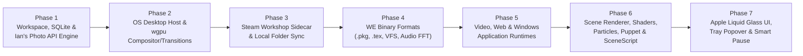

# 05 — Implementation Roadmap, Dependencies, Pitfalls & Verification Plan

## 1. Phased Implementation Plan for Coding Agents

### 1.0 Multi-Agent Execution Workflow (Lead Reviewer + Parallel Subagents)
1. **Independent Plan Review First**: Before writing code, review `PLAN.md`, `docs/01` through `docs/06`, and the existing scaffolded files in `src/` and `src-tauri/` to verify all cross-crate types, SQLite tables, and Tauri IPC signatures. Update the docs if you spot any refinements needed.
2. **Orchestrator + Subagents**: Keep the main agent context focused on coordination, code review, and running tests (`npm test`, `npm run build`, `cd src-tauri && cargo test --workspace`). Delegate crate and UI implementation in parallel waves to subagents (assigning disjoint crates/directories per subagent):
   - **Wave 1 (Core Crates)**:
     - Subagent 1A: `crates/truongpaper-core` & `crates/truongpaper-photo-api` (`docs/02-PHOTO-API-AND-CACHE-SPEC.md`)
     - Subagent 1B: `crates/truongpaper-steam` (`docs/03-WALLPAPER-ENGINE-COMPATIBILITY-SPEC.md` Section 1)
     - Subagent 1C: `crates/truongpaper-we-formats` (`docs/03-WALLPAPER-ENGINE-COMPATIBILITY-SPEC.md` Sections 2, 3, 5.4, 8)
     - Subagent 1D: `crates/truongpaper-audio` & `crates/truongpaper-scenescript` (`docs/01-SYSTEM-ARCHITECTURE.md` Section 4 & `docs/03-WALLPAPER-ENGINE-COMPATIBILITY-SPEC.md` Sections 6, 8.1)
   - **Wave 2 (Renderer & Platform Crates)**:
     - Subagent 2A: `crates/truongpaper-renderer` (`docs/01-SYSTEM-ARCHITECTURE.md` Section 3 & `docs/03-WALLPAPER-ENGINE-COMPATIBILITY-SPEC.md` Sections 4, 5)
     - Subagent 2B: `crates/truongpaper-platform` (`docs/01-SYSTEM-ARCHITECTURE.md` Sections 2, 5, 6 & `docs/03-WALLPAPER-ENGINE-COMPATIBILITY-SPEC.md` Section 7)
   - **Wave 3 (Tauri IPC Wiring & Liquid Glass Studio UI)**:
     - Subagent 3A: `src-tauri/src/` Tauri commands and power observer (`docs/02` Section 9, `docs/04` Section 5.1, `docs/01` Section 6.1)
     - Subagent 3B: `src/` and `tests/` full Studio UI views and Vitest tests (`docs/04-UI-UX-LIQUID-GLASS-SPEC.md` & `docs/06-REPO-STRUCTURE-README-AND-RELEASES-SPEC.md`)
3. **End-to-End Completion**: Continue through all waves and phases below until all crates, Tauri commands, and UI views are complete and `npm test`, `npm run build`, `cargo test --workspace`, and `cargo run --example wallpaper_smoke` pass.

The implementation is organized into **7 sequential phases** so each subsystem is unit-tested and runnable before the next layer is stacked on top.



---

### Phase 1: Workspace Scaffold, SQLite Schema & Ian's Photo API Engine
**Target Crates**: `truongpaper-core`, `truongpaper-photo-api`
- [ ] Initialize Cargo workspace + Tauri v2 + React 19 + TypeScript + Vite scaffold matching the exact manifests in Section 2.
- [ ] Implement SQLite schema (`photos_cache`, `photos_history`, `photos_blacklist`, `saved_albums`, `wallpaper_configs`, `wallpaper_presets`, `playlists`, `settings`) with WAL mode in `truongpaper-core` (copy directly from [`docs/02-PHOTO-API-AND-CACHE-SPEC.md`](file:///Users/iantruong/Desktop/Fun/TruongPaper/docs/02-PHOTO-API-AND-CACHE-SPEC.md)).
- [ ] Implement `PhotoApiClient` calling:
  - `GET https://photos-api.iantruongphotography.com/v1/photos/random` (supporting no params, `?featured=true`, `?album=<slug>`, and `?album=<slug>&featured=true`)
  - `GET https://iantruongphotography.com/api/public/albums?type=photo&limit=100` (official public album catalog discovery)
- [ ] Implement the 100 req / 5 min (`90` safe ceiling) sliding-window rate limiter and exponential backoff with jitter on `403`/`503`.
- [ ] Implement the **Queue & History Engine**:
  - Atomic `.jpg.part` $\to$ `wallpapers/photos/<id>.jpg` download.
  - Zero-API-call rotation from unused queue (`last_shown_at IS NULL`, `file_present = 1`, not in `photos_history` or `photos_blacklist`, matching orientation & active filter).
  - Record `id` in `photos_history` **only after** the desktop wallpaper swap succeeds.
  - Background refill keeping 5 unused photos on disk and triggering when queue drops to $\le 2$ (max 12 retry attempts per refill; exit cleanly after 4 consecutive `AlreadyInUnusedQueue` hits so albums with $< 5$ photos like `cape-horn-11-7` never loop or falsely reset history).
  - Auto-reset filter history when all photos in an album/filter have been shown (`consecutive_history_dups >= 10` and `unused_count == 0`).
  - Disk cache cleanup respecting `max_cache_bytes` (250 MB default), deleting oldest shown `.jpg` files (`file_present = 0`), protecting `is_favorite = 1` photos, and **never deleting `photos_history`**.
- [ ] **Phase 1 Verification Command**:
  ```bash
  cargo test -p truongpaper-core -p truongpaper-photo-api -- --nocapture
  ```

---

### Phase 2: Cross-Platform Desktop Window Host & `wgpu` Compositor
**Target Crates**: `truongpaper-platform`, `truongpaper-renderer`
- [ ] Implement macOS desktop window creator (`NSWindow` at `kCGDesktopWindowLevel`, `CanJoinAllSpaces | Stationary | IgnoresCycle`, ignoring `NSWindow.occlusionState`) per `NSScreen` (copy from [`docs/01-SYSTEM-ARCHITECTURE.md`](file:///Users/iantruong/Desktop/Fun/TruongPaper/docs/01-SYSTEM-ARCHITECTURE.md)).
- [ ] Implement Windows desktop window creator supporting **both** classic Windows 10/11 23H2 (`WorkerW` top-level sibling) **and** Windows 11 24H2 (`WS_EX_NOREDIRECTIONBITMAP` on `Progman`, `WS_CHILD | WS_EX_LAYERED` parented to `Progman` and Z-ordered immediately below `SHELLDLL_DefView`), with `TaskbarCreated` recovery.
- [ ] Implement passive desktop cursor coordinate & click hit-test forwarder on both macOS and Windows.
- [ ] Implement `wgpu` multi-monitor compositor using the exact WGSL shaders (`kawase_blur.wgsl` and `compositor.wgsl`) from [`docs/01-SYSTEM-ARCHITECTURE.md`](file:///Users/iantruong/Desktop/Fun/TruongPaper/docs/01-SYSTEM-ARCHITECTURE.md):
  - Orientation detection & fit modes (`Fill`, `Fit + Blur` Kawase dual-pass blur backdrop, `Fit + Black`, `Stretch`).
  - GPU transition shaders (`Smooth Crossfade`, `Blur-Dissolve`, `Liquid Glass Morph`) with configurable duration ($0.3\text{s}$–$3.0\text{s}$).
  - Universal post-processing color grading pass (Brightness, Contrast, Saturation, Hue Shift).
- [ ] **Phase 2 Verification Command**:
  ```bash
  cargo test -p truongpaper-platform -p truongpaper-renderer
  ```

---

### Phase 3: Steam Workshop Downloader Sidecar & Local Steam Folder Sync
**Target Crate**: `truongpaper-steam`
- [ ] Download and place `DepotDownloader` v3.4.0 native binaries into `crates/truongpaper-app/binaries/` with Tauri target-triple suffixes (`DepotDownloader-aarch64-apple-darwin`, `DepotDownloader-x86_64-apple-darwin`, `DepotDownloader-x86_64-pc-windows-msvc.exe`, `DepotDownloader-aarch64-pc-windows-msvc.exe`).
- [ ] Implement Workshop URL/ID parser supporting `steamcommunity.com/sharedfiles/filedetails/?id=...`, `steam://url/CommunityFilePage/...`, and raw numeric IDs.
- [ ] Implement public metadata client (`POST https://api.steampowered.com/ISteamRemoteStorage/GetPublishedFileDetails/v1/`) verifying `consumer_app_id == 431960`.
- [ ] Implement `DepotDownloader` sidecar wrapper reading raw byte chunks from `stderr` (for non-newline 2FA prompts) and parsing ASCII QR codes (`█`, `▀`, `▄`, `' '`) into `Vec<Vec<bool>>` for the Liquid Glass UI modal.
- [ ] Implement first-run bootstrap of Wallpaper Engine core `assets/` (`-app 431960 -depot 431961 -filelist core_assets_filter.txt`) into `<app_data_dir>/we_core_assets/`.
- [ ] Implement local Steam `libraryfolders.vdf` discovery and `notify` filesystem watcher on `steamapps/workshop/content/431960`.
- [ ] **Phase 3 Verification Command**:
  ```bash
  cargo test -p truongpaper-steam -- --nocapture
  ```

---

### Phase 4: Wallpaper Engine Binary Formats (`.pkg`, `.tex`, `.mdl`, 4-Layer VFS) & System Audio FFT
**Target Crates**: `truongpaper-we-formats`, `truongpaper-audio`
- [ ] Implement the 4-Layer Virtual File System (`WeVirtualFileSystem`) mounting `<wallpaper_dir>`, `scene.pkg`, `gifscene.pkg`, and `<app_data_dir>/we_core_assets/assets/`.
- [ ] Implement `.pkg` parser using `i32` length-prefixed strings (`read_string_i32_size`) and `memmap2::Mmap` zero-copy slices (copy from [`docs/03-WALLPAPER-ENGINE-COMPATIBILITY-SPEC.md`](file:///Users/iantruong/Desktop/Fun/TruongPaper/docs/03-WALLPAPER-ENGINE-COMPATIBILITY-SPEC.md)).
- [ ] Implement `.tex` decoder (`TEXV0005`, `TEXI0001`, `TEXB0001..0004` including the `FIF_MP4 (35)` `Version4` downgrade rule, `TEXS0001..0003`) using null-terminated strings (`read_n_string`), `lz4_flex::decompress`, BC1/BC2/BC3/RG88/R8/RGBA8 decoding, and NPOT UV scale calculation.
- [ ] Implement `.mdl` (`MDLV0005`/`MDLV0013`, `MDLS`, `MDLA`) puppet mesh parser with the 80-byte vertex stride (`pos: vec3, weight_indices: uvec4, weights: vec4, tc: vec2`).
- [ ] Implement system audio loopback capture (`WASAPI Loopback` on Windows; `CoreAudio Process Tap` / `ScreenCaptureKit` on macOS) + `SpectrumAnalyzer` (2048-point Hann-windowed `rustfft` from [`docs/01-SYSTEM-ARCHITECTURE.md`](file:///Users/iantruong/Desktop/Fun/TruongPaper/docs/01-SYSTEM-ARCHITECTURE.md)) producing smoothed 16-, 32-, and 64-band stereo arrays at 60 Hz.
- [ ] **Phase 4 Verification Command**:
  ```bash
  cargo test -p truongpaper-we-formats -p truongpaper-audio -- --nocapture
  ```

---

### Phase 5: Wallpaper Engine `Video`, `Web` & Windows `Application` Runtimes
**Target Crates**: `truongpaper-renderer`, `truongpaper-platform`
- [ ] **Video Runtime**: Implement hardware-accelerated video decoder (`VideoToolbox` / `D3D11VA`) rendering into `wgpu` compositor textures with gapless loop, playback speed (`0.1x`–`3.0x`), volume/mute, and embedded `.tex` MP4 support (`TEXB` with `free_image_format == 35`).
- [ ] **Web Runtime**: Implement `wry` desktop WebView host with `wpe://localhost/` VFS asset protocol, `web-wallpaper-preload.js` injection (`wallpaperPropertyListener` & `wallpaperRegisterAudioListener` 128-float stereo streaming), and desktop cursor event forwarding.
- [ ] **Application Runtime**: Implement Windows application wallpaper launcher with desktop bounds and flag `"type": "application"` items with a `"Windows Only"` badge on macOS.
- [ ] **Phase 5 Verification Command**:
  ```bash
  cargo test -p truongpaper-renderer --test video_web_runtime_tests
  ```

---

### Phase 6: Wallpaper Engine `Scene` Renderer & SceneScript Engine
**Target Crates**: `truongpaper-renderer`, `truongpaper-scenescript`
- [ ] Implement `scene.json` scene-graph loader (orthographic/perspective camera, mouse parallax, camera shake, image/composition/solid layers, sound objects).
- [ ] Implement Wallpaper Engine Shader Preprocessor (`#include` against 4-layer VFS, `// [COMBO]`, uniform comment metadata, `#define` translation header, and the 5 source compatibility rewrites from [`docs/03-WALLPAPER-ENGINE-COMPATIBILITY-SPEC.md`](file:///Users/iantruong/Desktop/Fun/TruongPaper/docs/03-WALLPAPER-ENGINE-COMPATIBILITY-SPEC.md)) and compile via `naga` to `wgpu::RenderPipeline`.
- [ ] Implement multi-pass FBO effect chains (`_rt_FullFrameBuffer`, ping-pong buffers, blend modes, bloom).
- [ ] Implement CPU/SIMD + GPU Particle Simulator matching the exact `17-float` (`68-byte`) sprite and `26-float` (`104-byte`) rope vertex layouts.
- [ ] Implement `.mdl` skeletal bone and morph target deformer.
- [ ] Implement `rquickjs` SceneScript sandbox (`init`, `update`, `cursorMove`, `applyUserProperties`, `engine.registerAudioBuffers`, `thisLayer`, `thisScene`, `Vec2/3/4`).
- [ ] **Phase 6 Verification Command**:
  ```bash
  cargo test -p truongpaper-scenescript -p truongpaper-renderer -- --nocapture
  ```

---

### Phase 7: Apple Liquid Glass UI, Tray Popover, Auto-Updater, CI/CD & `TruongFlix` Repo Format
**Target Directory**: `src/`, `src-tauri/`, `scripts/`, `.github/workflows/`, `README.md`
- [ ] Implement the cross-platform **Apple Liquid Glass Design System** (`LiquidGlassFilters.tsx`, `AmbientBacklightCanvas.tsx`, `liquid-glass.css`, bundled `InterVariable.woff2` font) from [`docs/04-UI-UX-LIQUID-GLASS-SPEC.md`](file:///Users/iantruong/Desktop/Fun/TruongPaper/docs/04-UI-UX-LIQUID-GLASS-SPEC.md).
- [ ] Build the **Main Studio Window** (`All Wallpapers`, `Ian's Photos API`, `Steam Workshop`, `Unified Playlists`, `Monitors & Fit`, `Settings`) + **Universal Paste Omnibar** + **Right-hand Dynamic Property Inspector (`PropertyInspector.tsx`)**.
- [ ] Build the **Menu Bar (macOS) / System Tray (Windows) Liquid Glass Popover** (`tray.html`) and browser preview mock (`src/dev/mockTauri.ts`).
- [ ] Implement the **Smart Pause, Occlusion, Sleep/Lock & Battery Policy Monitor** (`power.rs` + 250ms occlusion check).
- [ ] Implement the **Signed In-App Auto-Updater (`src/services/updates.ts`)**, sidecar bundler (`scripts/bundle-depotdownloader.mjs`), local release builder (`scripts/release.mjs`), `.github/workflows/ci.yml`, `.github/dependabot.yml`, and root `README.md` matching [`docs/06-REPO-STRUCTURE-README-AND-RELEASES-SPEC.md`](file:///Users/iantruong/Desktop/Fun/TruongPaper/docs/06-REPO-STRUCTURE-README-AND-RELEASES-SPEC.md).
- [ ] **Phase 7 Verification Command**:
  ```bash
  npm test && npm run build && cd src-tauri && cargo test --locked
  ```

---

## 2. Exact Workspace & Package Manifests (Aligned with `TruongFlix`)

### 2.1 `src-tauri/Cargo.toml`
```toml
[package]
name = "truongpaper"
version = "1.0.0"
description = "TruongPaper — dynamic desktop wallpaper engine & Ian Truong Photography API client"
authors = ["Ian Truong"]
edition = "2021"

[lib]
name = "truongpaper_lib"
crate-type = ["staticlib", "cdylib", "rlib"]

[workspace]
resolver = "2"
members = [
    ".",
    "crates/truongpaper-core",
    "crates/truongpaper-photo-api",
    "crates/truongpaper-steam",
    "crates/truongpaper-we-formats",
    "crates/truongpaper-renderer",
    "crates/truongpaper-scenescript",
    "crates/truongpaper-audio",
    "crates/truongpaper-platform",
]

[workspace.package]
version = "1.0.0"
edition = "2021"
license = "MIT"
rust-version = "1.82"

[build-dependencies]
tauri-build = { version = "2", features = [] }

[workspace.dependencies]
tokio = { version = "1.42", features = ["full"] }
serde = { version = "1.0", features = ["derive"] }
serde_json = "1.0"
anyhow = "1.0"
thiserror = "2.0"
tracing = "0.1"
tracing-subscriber = { version = "0.3", features = ["env-filter"] }
parking_lot = "0.12"
arc-swap = "1.7"
crossbeam-channel = "0.5"
rand = "0.8"
url = "2.5"
http = "1.2"
percent-encoding = "2.3"
reqwest = { version = "0.12", default-features = false, features = ["json", "stream", "rustls-tls", "gzip"] }
rusqlite = { version = "0.32", features = ["bundled"] }
keyring = { version = "3.6", features = ["apple-native", "windows-native"] }
wgpu = "23.0"
naga = { version = "23.0", features = ["glsl-in", "wgsl-out", "spv-out"] }
bytemuck = { version = "1.20", features = ["derive"] }
glam = { version = "0.29", features = ["bytemuck", "serde"] }
image = { version = "0.25", default-features = false, features = ["jpeg", "png", "webp", "gif", "bmp", "tga"] }
imagesize = "0.13"
lz4_flex = "0.11"
memmap2 = "0.9"
rustfft = "6.2"
cpal = "0.15"
kira = "0.9"
rquickjs = { version = "0.8", features = ["bindgen", "classes", "array-buffer", "loader"] }
keyvalues-parser = "0.2"
notify = { version = "8.0", default-features = false, features = ["macos_fsevent"] }
raw-window-handle = "0.6"
tauri = { version = "2.2", features = ["macos-private-api", "tray-icon", "protocol-asset"] }
tauri-plugin-shell = "2.2"
tauri-plugin-dialog = "2.2"
tauri-plugin-autostart = "2.2"
tauri-plugin-updater = "2.2"
tauri-plugin-process = "2.2"
tauri-plugin-single-instance = "2.2"
windows = { version = "0.62", features = [
    "Win32_Foundation",
    "Win32_UI_WindowsAndMessaging",
    "Win32_UI_HiDpi",
    "Win32_Graphics_Gdi",
    "Win32_System_Com",
    "Win32_System_LibraryLoader",
    "Win32_System_Power",
    "Win32_System_RemoteDesktop",
    "Win32_System_SystemServices",
    "Win32_Media_Audio",
    "Win32_UI_Shell",
] }
objc2 = "0.6"
block2 = "0.6"
objc2-foundation = "0.3"
objc2-app-kit = "0.3"
objc2-core-graphics = "0.3"
core-graphics = "0.25"
core-foundation = "0.10"

[profile.release]
codegen-units = 1
lto = true
opt-level = "s"
panic = "abort"
strip = true

# Proc-macros are dlopen'ed at compile time; stripping them breaks loading on macOS.
[profile.release.build-override]
strip = false
```

### 2.2 Root `package.json` (Aligned with `TruongFlix`)
```json
{
  "name": "truongpaper",
  "private": true,
  "version": "1.0.0",
  "type": "module",
  "scripts": {
    "test": "vitest run",
    "dev": "vite",
    "build": "tsc --noEmit && vite build",
    "preview": "vite preview",
    "typecheck": "tsc --noEmit",
    "tauri": "tauri",
    "app:dev": "tauri dev",
    "bundle:depotdownloader": "node scripts/bundle-depotdownloader.mjs",
    "app:build": "node scripts/release.mjs"
  },
  "dependencies": {
    "@tauri-apps/api": "^2.2.0",
    "@tauri-apps/plugin-autostart": "^2.2.0",
    "@tauri-apps/plugin-dialog": "^2.2.0",
    "@tauri-apps/plugin-process": "^2.2.0",
    "@tauri-apps/plugin-shell": "^2.2.0",
    "@tauri-apps/plugin-updater": "^2.2.0",
    "framer-motion": "^11.15.0",
    "lucide-react": "^0.468.0",
    "react": "^19.0.0",
    "react-dom": "^19.0.0",
    "zustand": "^5.0.2"
  },
  "devDependencies": {
    "@tauri-apps/cli": "^2.2.0",
    "@testing-library/react": "^16.1.0",
    "@types/node": "^22.10.0",
    "@types/react": "^19.0.0",
    "@types/react-dom": "^19.0.0",
    "@vitejs/plugin-react": "^4.3.4",
    "autoprefixer": "^10.4.20",
    "jsdom": "^25.0.1",
    "postcss": "^8.4.49",
    "tailwindcss": "^3.4.17",
    "typescript": "~5.7.2",
    "vite": "^6.0.5",
    "vitest": "^2.1.8"
  }
}
```

### 2.3 Multi-Window Root `vite.config.ts`
```typescript
import { defineConfig } from 'vite';
import react from '@vitejs/plugin-react';
import { resolve } from 'path';

export default defineConfig({
  plugins: [react()],
  clearScreen: false,
  server: {
    port: 1420,
    strictPort: true,
  },
  build: {
    target: ['es2022', 'chrome110', 'safari16'],
    rollupOptions: {
      input: {
        main: resolve(__dirname, 'index.html'),
        tray: resolve(__dirname, 'tray.html'),
      },
    },
  },
});
```

---

## 3. Top 15 Engineering Pitfalls & "Do-Not-Do" List for Coding Agents

> [!CAUTION]
> Every item in the table below was verified against live endpoints, OS internals, `TruongFlix`, or reference implementations (`RePKG`, `linux-wallpaperengine`, `Lively Wallpaper`, `DepotDownloader`). **Do not deviate from these rules.**

| # | Subsystem | Pitfall / Trap | Mandatory Rule for Implementation Agent |
| :--- | :--- | :--- | :--- |
| **1** | **Win11 24H2 `WorkerW`** | On Windows 11 24H2 (Build 26100+), `Progman` has `WS_EX_NOREDIRECTIONBITMAP` (`0x00200000`) and `WorkerW` is a child of `Progman` rather than a top-level window. Calling `SPI_SETDESKWALLPAPER` destroys `WorkerW`. | Check `(GetWindowLongPtrW(progman, GWL_EXSTYLE) & WS_EX_NOREDIRECTIONBITMAP) != 0`. On 24H2, add `WS_CHILD \| WS_EX_LAYERED` + `SetLayeredWindowAttributes(..., 255, LWA_ALPHA)`, `SetParent(hwnd, progman)`, and `SetWindowPos(hwnd, shelldll_defview, ...)` to place the window directly below `SHELLDLL_DefView`. Never call `SPI_SETDESKWALLPAPER` on 24H2. |
| **2** | **macOS `NSWindow` Occlusion** | A window at `kCGDesktopWindowLevel` (`-2147483623`) is below all normal app windows, so macOS reports `NSWindowOcclusionStateVisible == 0` whenever any normal window covers it, pausing WebView/Metal timers. | Never rely on `NSWindow.occlusionState` to pause wallpaper rendering. Use `CGWindowListCopyWindowInfo` in `PolicyMonitor` to check actual per-monitor fullscreen/maximized occlusion. |
| **3** | **`.pkg` vs `.tex` Binary Strings** | `.pkg` and `.tex` use **different** binary string formats. Mixing them corrupts file offsets immediately. | In `.pkg` headers, read strings as `i32` length-prefixed (`read_string_i32_size`). In `.tex` headers (`TEXV`, `TEXI`, `TEXB`, `TEXS`), read strings as null-terminated C-strings (`read_n_string`). |
| **4** | **`TEXB0004` Version Downgrade** | `TEXB0004` adds extra MP4 fields before `mipmap_count`, **only** when `free_image_format == 35 (FIF_MP4)`. | If `container_version == TexbVersion::Version4` and `free_image_format != 35`, immediately downgrade `container_version` to `TexbVersion::Version3` before reading mipmaps. |
| **5** | **`.tex` NPOT UV Padding** | Non-power-of-two `.tex` textures pad GPU dimensions (`texture_width`, `texture_height`) while storing visible dimensions in (`image_width`, `image_height`). | Pass `uv_scale = vec2(image_width as f32 / texture_width as f32, image_height as f32 / texture_height as f32)` to vertex/fragment shaders so padded black borders are never sampled. |
| **6** | **Missing Core `assets/` in `.pkg`** | Workshop `scene.pkg` archives only bundle custom assets and omit standard Wallpaper Engine shaders (`shaders/common.h`, `genericimage2.vert/.frag`, `genericparticle.vert/.frag`). | Always resolve files through the **4-Layer VFS** (`<wallpaper_dir>` $\to$ `scene.pkg` $\to$ `gifscene.pkg` $\to$ `we_core_assets`). Auto-bootstrap `we_core_assets` via `DepotDownloader -app 431960 -depot 431961 -filelist` if local WE is not installed. |
| **7** | **Shader `mul(x, y)` Order** | Wallpaper Engine shaders write `mul(v, g_ModelViewProjectionMatrix)` expecting HLSL row-vector multiplication, whereas GLSL/WGSL uses column-major `M * v`. | Define `#define mul(x, y) ((y) * (x))` in the shader preprocessor preamble. |
| **8** | **`DepotDownloader` `stderr` Prompts** | `DepotDownloader`'s `ConsoleAuthenticator.cs` prints 2FA prompts (`"Please enter your 2 factor auth code..."`) to `stderr` **without a trailing newline**. | Read raw byte chunks (`AsyncReadExt::read(&mut [u8; 1024])`) from sidecar `stderr` rather than `BufReader::lines()`. |
| **9** | **Photo API Small-Album Refill Loop** | Some public albums on `iantruongphotography.com` have $< 5$ total photos (e.g. `cape-horn-11-7` has `imageCount: 1`). | Distinguish `CandidateStatus::AlreadyInUnusedQueue` vs `AlreadyInHistory`. Exit the refill loop cleanly as `Ok(RefillOutcome::SmallPoolFullyQueued)` after `4` consecutive `AlreadyInUnusedQueue` hits; never trigger history auto-reset when `unused_count > 0`. |
| **10** | **History Deletion on Cache Eviction** | Deleting `photos_history` rows when evicting `.jpg` files causes previously shown photos to be re-downloaded and shown again. | `evict_old_cached_files_preserving_history()` must **only** delete `.jpg` files on disk and `UPDATE photos_cache SET file_present = 0`. It must **never** delete rows from `photos_history`. |
| **11** | **WASAPI Loopback Silence Freeze** | On Windows WASAPI Loopback, when no application is outputting audio, WASAPI stops firing the capture callback entirely, freezing the last FFT spectrum frame on screen. | Push captured audio into `StereoRingBuffer` with `last_write: Instant`, and step `SpectrumAnalyzer::process_stereo_pcm` on a dedicated 60 Hz timer thread that feeds `[0.0; 2048]` whenever `last_write.elapsed() > 35ms`. |
| **12** | **Tauri v2 Capabilities & CloudFront CSP** | Tauri v2 blocks `data-tauri-drag-region`, file dialogs, and sidecars unless listed in `capabilities/default.json` for both `"main"` and `"tray-popover"`, and `GET /api/public/albums` serves thumbnails from `d1twwtwfz1yeo4.cloudfront.net`. | Include `"windows": ["main", "tray-popover"]` in `capabilities/default.json` and include `https://*.cloudfront.net` in `security.csp` `img-src`. |
| **13** | **Windows `cargo test` `0xc0000139` Crash** | `tauri-build` only links its Common Controls v6 manifest into `bin` targets, causing `cargo test` executables on Windows to load Common Controls v5 and crash with `STATUS_ENTRYPOINT_NOT_FOUND`. | Embed `windows-app-manifest.xml` into all targets in `src-tauri/build.rs` via `/MANIFEST:EMBED` and `WindowsAttributes::new_without_app_manifest()` (see [`docs/06-REPO-STRUCTURE-README-AND-RELEASES-SPEC.md`](file:///Users/iantruong/Desktop/Fun/TruongPaper/docs/06-REPO-STRUCTURE-README-AND-RELEASES-SPEC.md#L561-L598)). |
| **14** | **macOS Release Proc-Macro Strip Failure** | Setting `strip = true` in `[profile.release]` also strips proc-macro `.dylib` crates on macOS unless overridden, breaking `dlopen` during release builds. | Always include `[profile.release.build-override] strip = false` in `src-tauri/Cargo.toml`. |
| **15** | **`keyring` Crate No-Op Store & Multiple Prompts** | `keyring` v3 compiles with a no-op backend if `"apple-native"` and `"windows-native"` features are omitted, and storing multiple keys triggers repeated macOS Keychain prompts. | Enable `features = ["apple-native", "windows-native"]` on `keyring` and store all secrets inside a single JSON vault item (`service = "com.iantruong.truongpaper"`, `account = "vault"`). |
| **16** | **`wpe://` Custom Protocol `<video>`/`<audio>` `206 Partial Content`** | `WKWebView` (macOS) and `WebView2` (Windows) refuse to play or loop `<video>` or `<audio>` over custom schemes if `Range: bytes=start-end` returns `200 OK` instead of `206 Partial Content`. | Implement byte-range parsing (`StatusCode::PARTIAL_CONTENT`, `Accept-Ranges: bytes`, `Content-Range: bytes start-end/total`) in `handle_wpe_protocol_request` (see [`docs/03-WALLPAPER-ENGINE-COMPATIBILITY-SPEC.md`](file:///Users/iantruong/Desktop/Fun/TruongPaper/docs/03-WALLPAPER-ENGINE-COMPATIBILITY-SPEC.md#L1312-L1386)). |

---

## 4. Final Acceptance Criteria Checklist

1. **Ian Truong Photography API**:
   - [ ] Supports no-param, `?featured=true`, `?album=<slug>`, and `?album=<slug>&featured=true` queries on `GET https://photos-api.iantruongphotography.com/v1/photos/random`.
   - [ ] Supports browsing official public albums via `GET https://iantruongphotography.com/api/public/albums?type=photo&limit=100`, as well as pasting `https://iantruongphotography.com/album/<slug>` or `<slug>`. Multiple saved albums can be enabled at once.
   - [ ] Maintains a local queue of up to 5 unused photos on disk (`wallpapers/photos/<id>.jpg`) and refills in the background when dropping to $\le 2$.
   - [ ] Rotates wallpapers from the local queue with **zero API calls** at rotation time, recording `id` in `photos_history` after the wallpaper swap succeeds.
   - [ ] Checks `id` against the unused queue, persistent `photos_history`, and `photos_blacklist` *before* downloading `imageUrl`, capping retries at 12 per refill and handling albums with $< 5$ photos gracefully.
   - [ ] Evicts oldest shown `.jpg` files when exceeding the cache limit (250 MB default) while **retaining all shown IDs in `photos_history`** and never deleting favorited photos.
   - [ ] Automatically resets shown history for the active album/filter when all photos in that pool have been shown (with toggle to hold instead).
   - [ ] Skips portrait photos on landscape monitors (and vice-versa) by default, with an option to allow them using a GPU-blurred ambient backdrop (`Fit + Blur`).
2. **Wallpaper Engine & Steam Workshop**:
   - [ ] Pasting any Steam Workshop link downloads and installs the wallpaper via the bundled `DepotDownloader` v3.4.0 sidecar (with QR / 2FA auth); local Steam `431960` workshop folders also auto-sync.
   - [ ] Renders `Scene` (`.pkg`/`.tex`/`.mdl`, 4-layer VFS, shaders, particles, puppet warp, SceneScript), `Video`, `Web`, and (on Windows) `Application` wallpapers behind desktop icons on macOS and Windows (including Windows 11 24H2).
   - [ ] Full system audio reactivity (WASAPI Loopback on Windows, CoreAudio Tap / ScreenCaptureKit on macOS) and desktop mouse interaction.
   - [ ] Dynamically generates UI controls for all `project.json` user properties (with safe `condition` evaluation and localization lookup) and supports saving named presets.
3. **Cross-Platform UI, Performance & `TruongFlix` Repo Format**:
   - [ ] Identical Apple Liquid Glass UI (`LiquidGlassFilters.tsx` + `AmbientBacklightCanvas.tsx` + `liquid-glass.css`) across macOS and Windows in both the Main Studio Window and the Menu Bar / System Tray Popover.
   - [ ] Smart pause/mute when fullscreen apps/games or maximized windows are active, when locked/asleep (`power.rs`), or when on battery / Low Power Mode.
   - [ ] Matches `TruongFlix` repository layout, `README.md` structure, `scripts/bundle-depotdownloader.mjs`, `scripts/release.mjs`, `.github/workflows/ci.yml` automated GitHub Releases (`TruongPaper-macOS.dmg`, `TruongPaper-Windows-Setup.exe`, `TruongPaper-macOS.app.tar.gz`, `latest.json`, `SHA256SUMS`), and in-app signed auto-updater (`src/services/updates.ts`).
